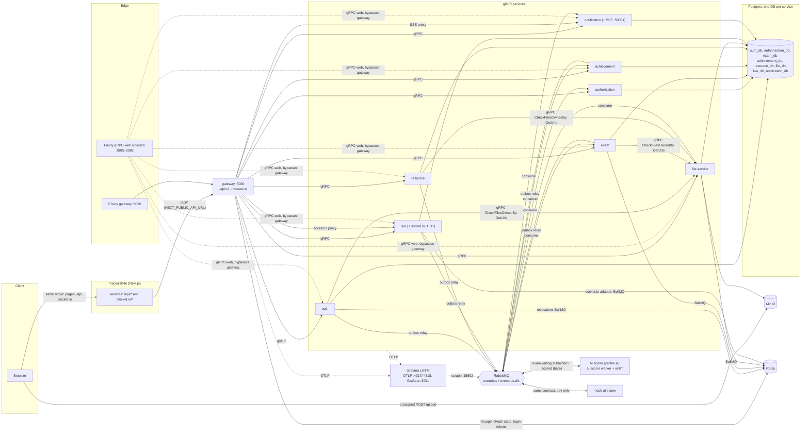
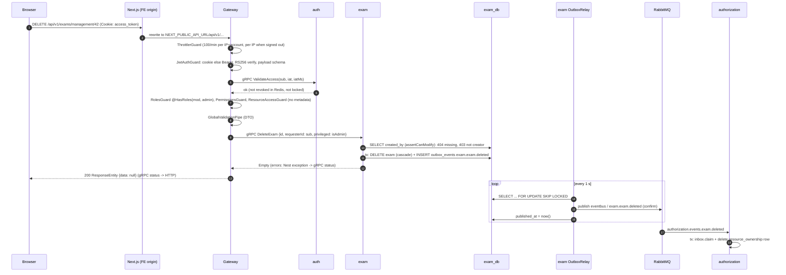

# Architecture overview

A map of the whole system on branch `chore/local-dev-fixes`, verified against the code (paths are given so each claim can be checked). Start here, then go to the detail pages.

| Page                                                               | What it covers                                                                                                                   |
| ------------------------------------------------------------------ | -------------------------------------------------------------------------------------------------------------------------------- |
| [services-and-data.md](services-and-data.md)                       | Every service: Prisma tables, gRPC RPCs, events published/consumed, infra used                                                   |
| [authorization.md](authorization.md)                               | JWT and cookie sessions, Google login, role gates, `@ResourceAccess`, requester pattern, five traced examples, target vs current |
| [messaging.md](messaging.md)                                       | Envelope, outbox + relay, inbox, RabbitMQ topology with retries and DLQs, full event table, before/after this branch             |
| [flows/](flows/README.md)                                          | **Per operation**: route → gRPC → service → tables → outbox events → consumers, plus Redis, MinIO, BullMQ, socket.io and SSE     |
| [operations.md](operations.md)                                     | Cross-cutting env vars, health endpoints, dashboards, alerts, ports                                                              |
| [`../operations/observability.md`](../operations/observability.md) | Observability runbook (existing)                                                                                                 |
| [`../operations/upgrade-notes.md`](../operations/upgrade-notes.md) | Deploy order for this branch (existing)                                                                                          |
| [`../backlog.md`](../backlog.md)                                   | Known open issues                                                                                                                |

## 1. System at a glance

- **Frontend** (separate repo `meowlish-fe`, Next.js): the browser talks only to the frontend's origin. `next.config.ts` rewrites `/api/*` to the gateway and `/socket.io/*` to the gateway's live proxy, so session cookies are first-party.
- **Gateway** (`apps/gateway`): the only HTTP API. `/api/v1/*`, Scalar docs at `/reference`, health at `/health/*`. Verifies JWTs (RS256 public key), applies throttling, role/permission and ownership guards, and calls services over gRPC. Proxies socket.io to live and SSE to notification.
- **gRPC services**: `auth`, `authorization`, `exam`, `achievement`, `resource`, `file-service`, `live`, `notification`. One Postgres database each (Prisma). Events over RabbitMQ through a transactional outbox.
- **AI writing scorer** (Docker profile `ai`): `ai-llm` (llama.cpp running the fine-tuned Phi-3 IELTS model) and `ai-scorer` (the external `ai-language-evaluator` worker, built from a pinned commit with local patches, `docker/ai-scorer`). **mock-ai-scorer** (`apps/mock-ai-scorer`, profile `mock-ai`) is a random-score stand-in. Run one or the other; both speak only RabbitMQ.
- **Infrastructure** (`docker/docker-compose.db.yaml`): Postgres 18, Redis (redis-stack), MinIO, RabbitMQ 4.2 with management, prometheus and shovel plugins, Adminer.
- **Envoy** (`docker/docker-compose.app.yaml`, `docker/envoy/*.yaml`): one sidecar per app except authorization and mock-ai-scorer. The gateway's is an HTTP proxy on 8080 that sets `X-Forwarded-For`; the others expose each gRPC service over gRPC-web on a host port.
- **Observability**: `@server/telemetry` (`libs/telemetry`) starts OpenTelemetry before Nest in every `main.ts` and provides `/health/live` + `/health/ready`; data goes over OTLP to Grafana LGTM (`docker/docker-compose.observability.yaml`) with provisioned dashboards and alerts (`docker/observability/`).

## 2. A request end to end

Example: a moderator deletes an exam they created, `DELETE /api/v1/exams/management/:id`.

Notes on the path:

- Global guard order is the `APP_GUARD` order in `apps/gateway/src/gateway.module.ts`; filters `GlobalHttpExceptionFilter`, `gRPC2HttpExceptionFilter`, `HttpExceptionFilter`; interceptors `HttpResponseTransformInterceptor` (the `ResponseEntity` envelope: `path`, `statusCode`, `success`, `timestamp`, `error`, `data`) and `GlobalClassSerializerInterceptor`.
- Service side: `GlobalRpcExceptionFilter` maps Nest HTTP exceptions to gRPC codes (`libs/utils/src/filters/global.rpc.filter.ts`); the gateway maps them back (`libs/utils/src/filters/rpc-to-http.http.filter.ts`), e.g. `PERMISSION_DENIED` ↔ 403, `NOT_FOUND` ↔ 404.
- The JWT is **not** forwarded to services; the gateway passes identity as message fields (`requesterId`, `privileged`, `userId`, `recipientId`). See [authorization.md](authorization.md).

## 3. Architectural patterns used

| Pattern                                                                  | Where                                                                                                                              |
| ------------------------------------------------------------------------ | ---------------------------------------------------------------------------------------------------------------------------------- |
| DDD layers `presentation/app/domain/infra` + CQRS (`@nestjs/cqrs`)       | auth, exam, achievement, file-service, live (partly: `app/services`), notification. resource uses plain services in `app/services` |
| Database per service, Prisma client per service (`@prisma-client/<svc>`) | `apps/*/prisma/schema/`                                                                                                            |
| `@nestjs-cls/transactional` (`TransactionHost`, `@Transactional()`)      | all DB access                                                                                                                      |
| Transactional outbox + relay, idempotent inbox                           | `libs/messaging` ([messaging.md](messaging.md))                                                                                    |
| Per-consumer retry queues + DLQ                                          | `defineConsumerQueue` ([messaging.md §6](messaging.md#6-rabbitmq-topology))                                                        |
| Optimistic locking with in-process retry                                 | exam `attempts.version`, achievement criteria `version`, `retryOnConflict`                                                         |
| Periodic jobs (BullMQ on Redis)                                          | auth/exam `publish-deleted-files` every 60 s; file-service `cleanup-orphaned-files` every 5 min                                    |
| Contract-first gRPC                                                      | `proto/*.proto` → `libs/generated` (ts-proto, `pnpm proto:gen`)                                                                    |
| Config validated at boot (zod)                                           | `apps/<svc>/src/configs/config.ts`                                                                                                 |
| `main.ts` → `startTelemetry()` → `bootstrap.ts`                          | every app (`libs/telemetry/src/lib/start-telemetry.ts`)                                                                            |

## 4. Observability in one paragraph

`startTelemetry({ serviceName })` (`libs/telemetry/src/lib/start-telemetry.ts`) runs the OpenTelemetry Node SDK with OTLP traces, metrics (15 s) and logs (Winston transport), auto-instrumentation minus `fs` and `/health/*`, and flushes on `SIGTERM` (max 5 s). `HealthModule.forRoot({ serviceName, prismaToken?, rabbitmq? })` adds `/health/live`, `/health/ready`, the `service_ready` gauge, and the gRPC latency interceptor (`rpc_server_duration`). Messaging adds `outbox_*`, `inbox_duplicates_total` and `consumer_failures_total`. Grafana provisions the "Platform status" and "Messaging" dashboards and the `ServiceNotReady`, `ServiceMissing`, `OutboxStuck`, `DeadLetters` alerts. Details: [operations.md](operations.md) and [`../operations/observability.md`](../operations/observability.md).

## 5. What is current and what is planned

| Topic             | Current (code)                                                                                                               | Planned (docs only)                                                                                                                                                                                                 |
| ----------------- | ---------------------------------------------------------------------------------------------------------------------------- | ------------------------------------------------------------------------------------------------------------------------------------------------------------------------------------------------------------------- |
| Authorization     | Gateway role gates; `@ResourceAccess` on blogs, flash cards, room delete/schedule; requester pattern in exam, resource, live | Hybrid design (`docs/superpowers/specs/2026-11-12-hybrid-authorization-design.md`): relationship tuples in authorization, synced local snapshots, sensitive deletes via authorization, `Actor` from a forwarded JWT |
| Messaging         | Outbox/inbox everywhere, retries and DLQs                                                                                    | Drop legacy bare-payload support; `mandatory` publishes (backlog)                                                                                                                                                   |
| Durable workflows | In-process scoring after commit, BullMQ sweeps                                                                               | Restate proposal (`docs/superpowers/specs/2026-11-12-restate-adoption-design.md`, "not approved and not implemented")                                                                                               |

## 6. Things I could not verify from this repo

- The AI scorer's own code lives in another repository (`linhma139/ai-language-evaluator`); this repo pins a commit and patches it (`docker/ai-scorer`). Its end-to-end behaviour was checked on the running stack (one IELTS Writing attempt, November 2026), not under load.
- Production topology: whether the Envoy sidecar ports are reachable from outside, what reverse proxy sits in front of the frontend, and which `TRUST_PROXY` value production uses.
- Runtime behaviour in general: apart from the AI scorer round trip, everything here is read from code and config, not observed on a running system. Observations that look like bugs are marked as such in the detail pages (report files and orphan cleanup in services-and-data.md; P2002 catches inside transactions in messaging.md §11).
