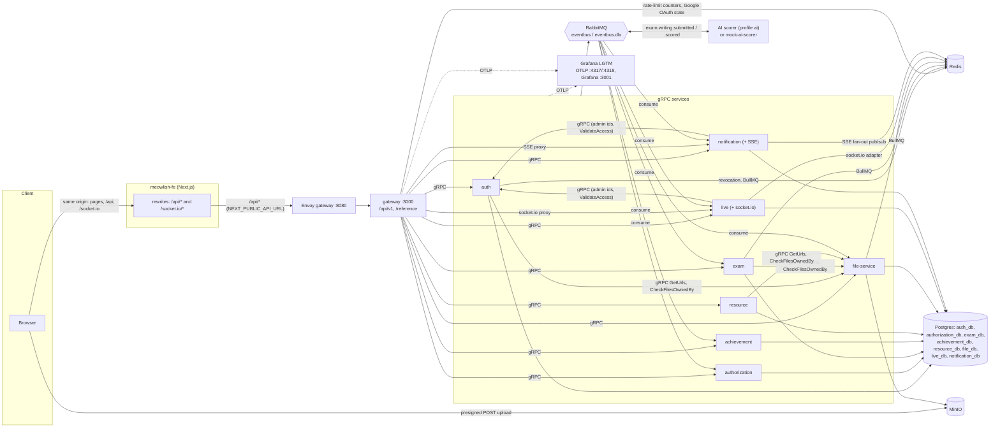
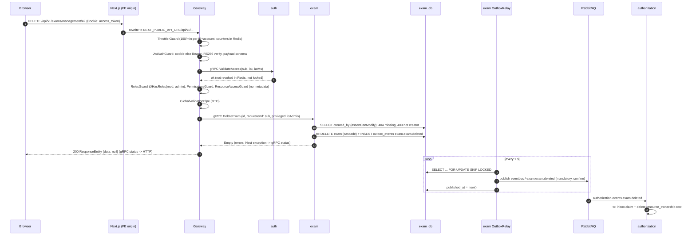

# Architecture overview

The whole system on one page, verified against the code (paths are given so each claim can be checked). Start here; every other document is linked from the map below.

## Documentation map

| Document                                   | Read it for                                                                                                        |
| ------------------------------------------ | ------------------------------------------------------------------------------------------------------------------ |
| This page                                  | How the pieces fit, which technology each service uses, shared libraries, patterns                                 |
| `apps/<service>/README.md`                 | One service: what it does, tech used, who it talks to, tables, Redis keys, env vars, how to run it (links below)   |
| [authorization.md](authorization.md)       | Who may do what: role gates, `@ResourceAccess`, the requester pattern, tokens and sessions, design vs what's built |
| [messaging.md](messaging.md)               | Events: envelope, outbox + relay, inbox, RabbitMQ topology with retries and dead letters, the full event table     |
| [flows/](#operation-flows)                 | **Per operation**: route → gRPC → service → tables → events → consumers                                            |
| [`../operations.md`](../operations.md)     | Running it: open Grafana / RabbitMQ / MinIO / Adminer, health, alerts, ports, upgrades, backups                    |
| [`../roadmap.md`](../roadmap.md)           | Every open concern and future plan in one list (replaces the old backlog and plan/spec files)                      |
| [`../fixed-issues.md`](../fixed-issues.md) | History: what was fixed, how, and how it was tested                                                                |
| [`../../README.md`](../../README.md)       | Local setup, Docker, demo account, common commands                                                                 |
| [`../../AGENTS.md`](../../AGENTS.md)       | Coding rules for this repo (formatting, DTOs, layers, messaging, auth conventions)                                 |

## 1. System at a glance

- **Frontend** (separate repo `meowlish-fe`, Next.js): the browser talks only to the frontend's origin. `next.config.ts` rewrites `/api/*` to the gateway and `/socket.io/*` to the gateway's live proxy, so session cookies are first-party.
- **Gateway** (`apps/gateway`): the only HTTP API. `/api/v1/*`, Scalar docs at `/reference`, health at `/health/*`. Verifies JWTs (RS256 public key), rate-limits (counters in Redis), applies role/permission and ownership guards, and calls services over gRPC. Proxies socket.io to live and SSE to notification.
- **gRPC services**: `auth`, `authorization`, `exam`, `achievement`, `resource`, `file-service`, `live`, `notification`. One Postgres database each (Prisma). They exchange events over RabbitMQ through a transactional outbox.
- **AI writing scorer** (Docker profile `ai`): `ai-llm` (llama.cpp running the fine-tuned Phi-3 IELTS model) and `ai-scorer` (the external `ai-language-evaluator` worker, built from a pinned commit with local patches, `docker/ai-scorer`). **mock-ai-scorer** (`apps/mock-ai-scorer`, profile `mock-ai`) is a random-score stand-in. Run one or the other; both speak only RabbitMQ.
- **Infrastructure** (`docker/docker-compose.db.yaml`): Postgres 18, Redis (redis-stack, with RedisInsight), MinIO, RabbitMQ 4.2 with management, prometheus and shovel plugins, Adminer.
- **Envoy** (`docker/docker-compose.app.yaml`, `docker/envoy/*.yaml`): the gateway's sidecar is an HTTP proxy (default 8080) that sets `X-Forwarded-For`; the other sidecars expose each gRPC service over gRPC-web. All infrastructure and Envoy ports bind to `127.0.0.1` in production.
- **Observability**: `@server/telemetry` starts OpenTelemetry before Nest in every `main.ts` and provides `/health/live` + `/health/ready`; data goes over OTLP to Grafana LGTM (`docker/docker-compose.observability.yaml`) with provisioned dashboards and alerts. How to open the panels: [`../operations.md`](../operations.md#open-the-panels).

## 2. Services and the technology each uses

Each service's README has the full table (with the files where each piece is wired). The summary:

| Service                                               | Transport                             | Database (`apps/<svc>/prisma`) | Redis                                                         | BullMQ jobs                      | RabbitMQ                                                        | Calls over gRPC                                   | Other                                                        |
| ----------------------------------------------------- | ------------------------------------- | ------------------------------ | ------------------------------------------------------------- | -------------------------------- | --------------------------------------------------------------- | ------------------------------------------------- | ------------------------------------------------------------ |
| [gateway](../../apps/gateway/README.md)               | HTTP (Express), socket.io + SSE proxy | -                              | throttler counters (`ioredis`), Google OAuth state and tokens | -                                | -                                                               | every service                                     | Passport JWT + Google OAuth, Swagger + Scalar, throttler     |
| [auth](../../apps/auth/README.md)                     | gRPC                                  | `auth_db`, migrations          | token revocation, refresh-token rotation, BullMQ              | `publish-deleted-files` (60 s)   | publishes (outbox)                                              | file-service                                      | `@nestjs/jwt` (RS256 signing), bcrypt, Google token endpoint |
| [authorization](../../apps/authorization/README.md)   | gRPC                                  | `authorization_db`, `db push`  | -                                                             | -                                | consumes `*.created` / `*.deleted` ownership events             | -                                                 | -                                                            |
| [exam](../../apps/exam/README.md)                     | gRPC                                  | `exam_db`, migrations          | BullMQ                                                        | `publish-deleted-files` (60 s)   | publishes; consumes its own scoring events and the AI scorer's  | file-service                                      | CQRS, optimistic locking, slug backfill                      |
| [achievement](../../apps/achievement/README.md)       | gRPC                                  | `achievement_db`, migrations   | -                                                             | -                                | consumes login/attempt events, publishes `badge.earned`         | -                                                 | CQRS, optimistic locking                                     |
| [resource](../../apps/resource/README.md)             | gRPC                                  | `resource_db`, `db push`       | -                                                             | -                                | publishes (outbox)                                              | file-service                                      | file reference counting, slug backfill                       |
| [file-service](../../apps/file-service/README.md)     | gRPC                                  | `file_db`, migrations          | BullMQ                                                        | `cleanup-orphaned-files` (5 min) | consumes `*.file.added` / `*.file(s).removed`                   | -                                                 | MinIO (presigned POST, public/private buckets)               |
| [live](../../apps/live/README.md)                     | gRPC + socket.io (HTTP)               | `live_db`, `db push`           | socket.io Redis adapter                                       | -                                | publishes room events; consumes `auth.user.locked`              | auth (`ValidateAccess` on every socket handshake) | `jsonwebtoken` (verifies socket tokens)                      |
| [notification](../../apps/notification/README.md)     | gRPC + SSE (HTTP)                     | `notification_db`, `db push`   | SSE fan-out (pub/sub, `ioredis`)                              | -                                | consumes badge, report, comment, forum and proposal events      | auth (admin ids)                                  | -                                                            |
| [mock-ai-scorer](../../apps/mock-ai-scorer/README.md) | HTTP (health only)                    | -                              | -                                                             | -                                | consumes `exam.writing.submitted`, publishes `.scored` directly | -                                                 | zod; the real scorer it stands in for is described there     |

Common to every service: NestJS 11, `nestjs-cls` + `@nestjs-cls/transactional` for transactions, `@server/messaging` (outbox relay, inbox), `@server/telemetry` (OpenTelemetry, health), zod-validated config (`apps/<svc>/src/configs/config.ts`).

**Data rules.** Every service with a database owns exactly one Postgres database (`docker/postgres/init-databases.sql`) and its own generated Prisma client (`@prisma-client/<svc>`). No service reads another service's database at runtime; the only cross-database code is the authorization seed. Every database also has the two messaging tables `outbox_events` and `inbox_events` ([messaging.md](messaging.md)). Schema changes: auth, exam, achievement and file-service use `prisma migrate`; authorization, live, notification and resource use `prisma db push` ([`../operations.md`](../operations.md#deploying-an-upgrade)).

**Synchronous calls between services** are few: auth, exam and resource call file-service (`GetUrls` to show files, `CheckFilesOwnedBy` before attaching one); notification calls auth (`FindIdentityIdsByRole`) to find the admins to tell about a report; live calls auth (`ValidateAccess`) on each socket handshake. Everything else between services is events.

## 3. A request end to end

Example: a moderator deletes an exam they created, `DELETE /api/v1/exams/management/:id`.

Notes on the path:

- Global guard order is the `APP_GUARD` order in `apps/gateway/src/gateway.module.ts`; filters `GlobalHttpExceptionFilter`, `gRPC2HttpExceptionFilter`, `HttpExceptionFilter`; interceptors `HttpResponseTransformInterceptor` (the `ResponseEntity` envelope: `path`, `statusCode`, `success`, `timestamp`, `error`, `data`) and `GlobalClassSerializerInterceptor`.
- Service side: `GlobalRpcExceptionFilter` maps Nest HTTP exceptions to gRPC codes (`libs/utils/src/filters/global.rpc.filter.ts`); the gateway maps them back (`libs/utils/src/filters/rpc-to-http.http.filter.ts`), e.g. `PERMISSION_DENIED` ↔ 403, `NOT_FOUND` ↔ 404.
- The JWT is **not** forwarded to services; the gateway passes identity as message fields (`requesterId`, `privileged`, `userId`, `recipientId`). See [authorization.md](authorization.md).

## 4. Shared libraries (`libs/`)

Imported through their `@server/*` alias (never by relative path). Build and test each with `pnpm exec nx build <lib>` / `pnpm exec nx test <lib>` (Jest; specs sit next to the source).

| Lib                               | Purpose                                                                                                                                                                 |
| --------------------------------- | ----------------------------------------------------------------------------------------------------------------------------------------------------------------------- |
| `@server/generated` (`generated`) | Code generated from `proto/*.proto` with ts-proto (`pnpm proto:gen`). Never hand-edit                                                                                   |
| `@server/utils` (`utils`)         | Validation pipe, exception filters (HTTP ↔ gRPC), interceptors, pagination DTOs and cursors, `slugify`, CQRS base classes, RMQ config, decorators for OpenAPI responses |
| `@server/messaging` (`messaging`) | Event envelope, `OutboxPublisher`, `OutboxRelay`, `InboxService`, `defineConsumerQueue` (retry queues + DLQ), messaging Prisma schema                                   |
| `@server/telemetry` (`telemetry`) | `startTelemetry` (OpenTelemetry SDK, OTLP), `HealthModule` (`/health/live`, `/health/ready`, `service_ready`, gRPC latency metric)                                      |
| `@server/database` (`database`)   | Prisma/Postgres helpers (`resolveDatabaseUrl`)                                                                                                                          |
| `@server/logger` (`logger`)       | Winston logger (`LoggerModule`, `AppLoggerService`)                                                                                                                     |
| `@server/typing` (`typing`)       | Shared enums (`Role`, `Permission`, `SortDirection`) and utility types (`DeepPartial`, `DeepStringify`, `Complete`)                                                     |

## 5. Architectural patterns used

| Pattern                                                                  | Where                                                                                                                              |
| ------------------------------------------------------------------------ | ---------------------------------------------------------------------------------------------------------------------------------- |
| DDD layers `presentation/app/domain/infra` + CQRS (`@nestjs/cqrs`)       | auth, exam, achievement, file-service, live (partly: `app/services`), notification. resource uses plain services in `app/services` |
| Database per service, Prisma client per service (`@prisma-client/<svc>`) | `apps/*/prisma/schema/`                                                                                                            |
| `@nestjs-cls/transactional` (`TransactionHost`, `@Transactional()`)      | all DB access                                                                                                                      |
| Transactional outbox + relay, idempotent inbox                           | `libs/messaging` ([messaging.md](messaging.md))                                                                                    |
| Per-consumer retry queues + DLQ                                          | `defineConsumerQueue` ([messaging.md](messaging.md))                                                                               |
| Ownership decided by the owning service (requester pattern)              | exam, resource, live, file attachments ([authorization.md](authorization.md))                                                      |
| File reference counting through events                                   | auth avatars, exam files, report attachments, flash card images → file-service                                                     |
| Optimistic locking with in-process retry                                 | exam `attempts.version`, achievement criteria `version`, `retryOnConflict`                                                         |
| Periodic jobs (BullMQ on Redis)                                          | auth/exam `publish-deleted-files` every 60 s; file-service `cleanup-orphaned-files` every 5 min                                    |
| Readable slugs (set once, id or slug accepted)                           | exams, blog posts, forum threads (`slugify` / `nextFreeSlug` in `@server/utils`)                                                   |
| Contract-first gRPC                                                      | `proto/*.proto` → `libs/generated`                                                                                                 |
| Config validated at boot (zod)                                           | `apps/<svc>/src/configs/config.ts`                                                                                                 |
| `main.ts` → `startTelemetry()` → `bootstrap.ts`                          | every app (`libs/telemetry/src/lib/start-telemetry.ts`)                                                                            |

## 6. Observability in one paragraph

`startTelemetry({ serviceName })` runs the OpenTelemetry Node SDK with OTLP traces, metrics (15 s) and logs (Winston transport), auto-instrumentation minus `fs` and `/health/*`, and flushes on `SIGTERM`. `HealthModule.forRoot(...)` adds `/health/live`, `/health/ready`, the `service_ready` gauge and the gRPC latency metric. Messaging adds `outbox_*`, `inbox_duplicates_total` and `consumer_failures_total`. Grafana provisions the "Platform status" and "Messaging" dashboards and the `ServiceNotReady`, `ServiceMissing`, `OutboxStuck` and `DeadLetters` alerts. To open them, and what to do when an alert fires: [`../operations.md`](../operations.md).

## Operation flows

What happens inside the system for every operation: the HTTP route, the gRPC call, the service code, the tables it reads and writes, the transaction, the outbox events, the consumers that react (and whether they use the inbox), Redis, MinIO, BullMQ, socket.io and SSE. Every step names the file it comes from.

| Page                                                                         | Operations                                                                                                                                                                                |
| ---------------------------------------------------------------------------- | ----------------------------------------------------------------------------------------------------------------------------------------------------------------------------------------- |
| [auth.md](flows/auth.md)                                                     | `/auth/*`: mail and Google sign-in, cookies, refresh, logout, credentials, password, profile and avatar, identities, roles and permissions, locking, Google Calendar linking              |
| [exam.md](flows/exam.md)                                                     | `/exams/*`: exam, section and question management, review, tags, goals; attempts (start, answers, notes, flags, submit), scoring, the Writing round trip with the AI scorer               |
| [resource.md](flows/resource.md)                                             | `/resources/*`: blogs and tags, blog comments, flash cards and lists, reports                                                                                                             |
| [resource-community.md](flows/resource-community.md)                         | `/resources/forum/*`, flash card copies, diff, upstream pull and change proposals; the discussion and proposal notifications                                                              |
| [live-and-notification.md](flows/live-and-notification.md)                   | `/chat/*` and the socket.io proxy; `/notifications/*`, preferences and the SSE stream; badge and report notifications                                                                     |
| [achievement-file-authorization.md](flows/achievement-file-authorization.md) | `/achievements/*` and badge awarding; `POST /files` (presigned upload), file reference counting and orphan cleanup; ownership checks behind `@ResourceAccess`; the outbox relay and inbox |

Each operation has the same bullets: **Access** (what the gateway checks, and what the service checks itself; services answer "not yours" with 404, not 403), **Flow** (numbered steps from the gateway DTO to the response), **Async** (what the emitted events cause elsewhere) and **Errors**. Each page ends with **Background work** (consumers, jobs, sockets) and **Findings** (problems noticed while tracing the code, each marked with what became of it; open ones are in [`../roadmap.md`](../roadmap.md)).

Shared mechanics are described once: gateway guards and throttling in [authorization.md](authorization.md) and `apps/gateway/src/throttle.ts` (throttler `default`: 100/min per route per IP+account, per IP when signed out; strict auth routes 10/min per IP+account plus a 100/min per-IP ceiling; answer autosave 300/min; counters shared in Redis); outbox, relay, inbox, retries and the event table in [messaging.md](messaging.md); tables per service in each `apps/<svc>/README.md`.
