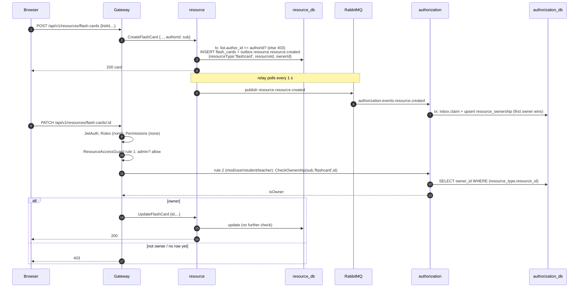

# Authentication and authorization

How a request is authenticated, how each kind of rule is enforced **today**, five traced examples, and how this compares with the target designs in `docs/superpowers/`. Everything here is read from the code on branch `chore/local-dev-fixes`; file paths are given for each claim.

## 1. Layers at a glance

| #   | Layer                                 | Where                                                                                                                                                                            | Decides                                                        | Failure            |
| --- | ------------------------------------- | -------------------------------------------------------------------------------------------------------------------------------------------------------------------------------- | -------------------------------------------------------------- | ------------------ |
| 1   | Authentication (JWT RS256)            | Gateway `JwtAuthGuard` + `JwtStrategy` (`apps/gateway/src/auth/guards/jwt-auth.guard.ts`, `apps/gateway/src/auth-gateway/strategies/jwt.strategy.ts`), auth `ValidateAccess` RPC | Who you are; token not revoked; account not locked             | 401 / 403 (locked) |
| 2   | Role and permission gates             | Gateway `RolesGuard`, `PermissionsGuard` (`apps/gateway/src/auth/guards/`) via `@HasRoles`, `@HasPermissions`                                                                    | Coarse capability by role/permission in the JWT                | 403                |
| 3   | Legacy ownership copy                 | Gateway `ResourceAccessGuard` + authorization service (`apps/authorization`) via `@ResourceAccess`                                                                               | Owner of a blog / flash card / room, from a copy fed by events | 403                |
| 4   | Requester pattern (local domain auth) | Gateway sends `requesterOf(req.user, ROLES)`; the owning service checks its own rows                                                                                             | Owner-or-privileged, visibility, file uploader                 | 404 / 403          |

Global guard order is the `APP_GUARD` registration order in `apps/gateway/src/gateway.module.ts`: `ThrottlerGuard` → `JwtAuthGuard` → `RolesGuard` → `PermissionsGuard` → `ResourceAccessGuard`. Route-level `@UseGuards(...)` (e.g. `CookieIssuanceGuard`) run after them. Every guard short-circuits on `@IsPublic()`.

Services do **not** verify the JWT themselves (except live for sockets): the gateway does not forward the token over gRPC, and services trust the `requesterId` / `privileged` / `userId` / `recipientId` fields of the request message. See §9 for what that implies.

## 2. Authentication

### Tokens

- auth signs with `JWT_PRIVATE_KEY` (RS256); only the gateway and live hold `JWT_PUBLIC_KEY`.
- Access token claims (`libs/utils/src/types/payload.type.ts` `payloadSchema`): `sub`, `roles[]`, `permissions[]`, `iat`, `iatMs` (ms issue time), `exp`, plus a random `jti` (`apps/auth/src/app/services/token.service.ts`). The refresh token carries `sub`, `iat`, `iatMs`, `exp`, `jti` (no roles/permissions).
- Default lifetimes (`apps/auth/src/configs/config.ts`): access **15 min** (`JWT_ACCESS_TOKEN_EXPIRATION`, default 900 s), refresh **7 days** (`JWT_REFRESH_TOKEN_EXPIRATION`, default 604800 s).

### Verification in the gateway

`JwtStrategy` (`passport-jwt`, name `access-jwt`):

1. **Extraction, cookie first**: `ExtractJwt.fromExtractors([cookieExtractor('access_token'), ExtractJwt.fromAuthHeaderAsBearerToken()])`. Browsers use the cookie; API clients and the Scalar UI may send `Authorization: Bearer`.
2. Signature and expiry with the public key, `algorithms: ['RS256']`.
3. `payloadSchema.safeParse` (a validly signed but malformed payload is 401, not 500).
4. gRPC `auth.ValidateAccess({ identityId, iat, iatMs })` → `ValidateAccessCommandHandler` (`apps/auth/src/app/commands/handlers/validate-access.handler.ts`):
   - revoked → 401: Redis key `jwt:blacklist:user:<id>` holds the revocation time in ms; every token with `iatMs` (or `iat*1000` for legacy tokens) `<=` that time is revoked (`TokenService.isTokenRevoked`). The key lives as long as a refresh token (`revokeUser` uses `setex` with the refresh TTL).
   - identity missing → 401; `isLocked` → 403 `Account locked`.
5. `req.user = { sub, permissions, roles }` (`Claims`).

`revokeUser` is called by `logout-all`, password change, `AssignRoleTo` and `RemoveRoleFrom` (`apps/auth/src/app/commands/handlers/*.handler.ts`), so a role change forces re-login and new claims. Locking an identity does not revoke tokens; it is enforced by the `isLocked` check above on every request.

## 3. Session cookies

All of this is in `apps/gateway/src/auth-gateway/auth-cookies.ts` and `auth.router.controller.ts`.

| Cookie          | Set by                                                                       | `Path`                         | Attributes                                                                                                   | `Max-Age`                  |
| --------------- | ---------------------------------------------------------------------------- | ------------------------------ | ------------------------------------------------------------------------------------------------------------ | -------------------------- |
| `access_token`  | `POST /auth/register`, `/auth/login`, `/auth/refresh`, `/auth/google/tokens` | `/`                            | `HttpOnly`, `SameSite=Lax`, `Secure` when `req.secure`, `X-Forwarded-Proto: https`, or `NODE_ENV=production` | from the token's own `exp` |
| `refresh_token` | same (only when the RPC returned one)                                        | `/api/v1/auth`                 | same                                                                                                         | from the token's own `exp` |
| `oauth2_state`  | `GET /auth/credentials/google` (linking only), `GoogleOAuth2Guard`           | `/api/v1/auth/google/callback` | `HttpOnly`, `SameSite=Lax`, `Secure` on HTTPS                                                                | 300 s                      |

Cookie-issuing routes return `data: null`; tokens never appear in a response body.

| Route                          | Guards                                                                                      | Effect                                                                                                                             |
| ------------------------------ | ------------------------------------------------------------------------------------------- | ---------------------------------------------------------------------------------------------------------------------------------- |
| `POST /api/v1/auth/register`   | `@IsPublic`, `CookieIssuanceGuard`, strict throttle by mail                                 | `auth.RegisterMail` → set both cookies                                                                                             |
| `POST /api/v1/auth/login`      | same                                                                                        | `auth.LoginMail` → set both cookies (also writes `auth.user.login` to the outbox)                                                  |
| `POST /api/v1/auth/refresh`    | `@IsPublic`, `CookieIssuanceGuard`, `JwtRefreshAuthGuard`, strict throttle by refresh token | `JwtRefreshStrategy` reads `refresh_token` cookie, else Bearer; `auth.ValidateRefresh` (revocation) → `auth.Refresh` → new cookies |
| `POST /api/v1/auth/logout`     | `@IsPublic`, `CookieIssuanceGuard`                                                          | Clears both cookies. **No server-side revocation**: a copied refresh token stays valid until it expires                            |
| `POST /api/v1/auth/logout-all` | authenticated                                                                               | `auth.LogOutAll` (revokes every token of the identity) → clears cookies                                                            |

### `CookieIssuanceGuard`

`apps/gateway/src/auth/guards/cookie-issuance.guard.ts`. `SameSite=Lax` does not stop a cross-site top-level navigation or form POST from **receiving** `Set-Cookie`, so the routes that set or clear cookies refuse:

- `Sec-Fetch-Site: cross-site` → 403 `Cross-site request refused`;
- an `Origin` that is neither in `CORS_ORIGINS` nor the gateway itself (`${req.protocol}://${req.get('host')}`, for the Scalar UI) → 403 `Origin not allowed`;
- requests with neither header (curl, mobile, server-to-server) pass.

`POST /auth/google/tokens` additionally requires `Content-Type: application/json` (415 otherwise), so a cross-site `<form>` can't trigger it even in a browser that sends neither header.

### Frontend proxy: cookies stay first-party

The browser only talks to the frontend's origin. `meowlish-fe/next.config.ts` rewrites:

- `/api/:path*` → `${NEXT_PUBLIC_API_URL}/api/:path*` (gateway), including `/api/v1/auth/google/callback`;
- `/socket.io/:path*` → `${NEXT_PUBLIC_API_URL}/api/v1/chat/ws/socket.io/:path*`.

So the session cookies are set by, and sent to, the frontend origin: they are first-party, `refresh_token`'s `Path=/api/v1/auth` matches the proxied path, and the gateway's origin doesn't need to be same-site with the frontend. What still matters:

- `CORS_ORIGINS` (gateway and live) must list the frontend origin, because the browser's `Origin` header is checked by `CookieIssuanceGuard` and by live's handshake `allowRequest` (`apps/live/src/app/infra/adapter/redis-io.adapter.ts`).
- `BASE_URL` is the frontend's public origin, so Google redirects back through the proxy (where `oauth2_state` lives).
- More than one frontend: list the others in `GOOGLE_OAUTH_FRONTENDS` and have each open `/auth/google` and `/auth/credentials/google` with `?frontend=${location.origin}`. The start guard (`GoogleOAuth2Guard`) stores that origin in the state and sends Google `<origin>/api/v1/auth/google/callback`; the callback guard (`GoogleOAuth2CallbackGuard`) reads it back, repeats the same `redirect_uri` in the code exchange, and the user lands on `<origin>` + the path of `FE_LOGIN_REDIRECT_URL`. An unlisted origin is 400, so the redirect can't be pointed elsewhere. No `frontend` (or the default frontend's own origin) keeps the single-frontend behaviour below.
- Next's built-in proxy doesn't add `X-Forwarded-For`; see [operations.md](operations.md) (`TRUST_PROXY`) and `docs/operations/upgrade-notes.md`.

### Live sockets

Gateway `LiveWsGatewayController` (`apps/gateway/src/live-ws-gateway/live-ws.router.controller.ts`, `@IsPublic`, all throttlers skipped) proxies `/api/v1/chat/ws/socket.io*` to live (`LIVE_SERVICE_WS_URL` or `LIVE_SERVICE_WS_HOST:PORT`), rewriting the path to `/socket.io/`. Live verifies the token itself (`apps/live/src/app/services/chat.gateway.ts`): `access_token` cookie first, then socket.io `auth.token`, `?token=`, or Bearer; `jwt.verify(…, RS256)`. Without `JWT_PUBLIC_KEY` every connection is refused.

### Google login and account linking

```mermaid
sequenceDiagram
  autonumber
  participant B as Browser
  participant FE as Frontend origin (Next proxy)
  participant G as Gateway
  participant R as Redis
  participant Go as Google
  participant A as auth

  Note over B,A: Login / register
  B->>FE: navigate GET /api/v1/auth/google
  FE->>G: proxied
  G-->>B: 302 to Google (no state; with ?frontend=<listed origin>: state=nonce, SET state = {frontend})
  B->>Go: consent
  Go-->>B: 302 BASE_URL/api/v1/auth/google/callback?code=...
  B->>FE: GET callback
  FE->>G: proxied
  G->>A: RegisterOrLoginGoogle(googleId)
  A-->>G: Tokens
  G->>R: SETEX oauth2:google:loginToken:uuid 60 s = Tokens
  G-->>B: 302 FE_LOGIN_REDIRECT_URL?loginToken=uuid
  B->>FE: POST /api/v1/auth/google/tokens {"loginToken": "..."} (application/json)
  FE->>G: proxied
  G->>G: CookieIssuanceGuard, JSON check
  G->>R: GET + DEL loginToken (single use)
  G-->>B: Set-Cookie access_token, refresh_token, body data null

  Note over B,A: Linking (already logged in)
  B->>FE: top-level navigation GET /api/v1/auth/credentials/google (sends access_token cookie)
  FE->>G: proxied, JwtAuthGuard ok
  G->>R: SET gateway:oauth2:state:nonce = {identityId, frontend?}, EX 300
  G-->>B: Set-Cookie oauth2_state=nonce, 302 to Google with state=nonce
  B->>Go: consent
  Go-->>B: 302 callback?code&state
  B->>FE: GET callback (oauth2_state cookie comes back)
  FE->>G: proxied
  G->>G: GET state key, state == cookie?, DEL (single use) -> identityId, frontend
  G->>A: AddGoogleCredential(googleId, identityId)
  G->>R: SETEX loginToken = true
  G-->>B: 302 FE_LOGIN_REDIRECT_URL?loginToken=...
  B->>G: POST /auth/google/tokens -> nothing to set (value is true)
```

Failures never end as a JSON page: `GoogleOAuthCallbackFilter` (`apps/gateway/src/auth-gateway/google-oauth-callback.filter.ts`) redirects to the flow's frontend callback page with `?error=<code>` (`ACCESS_DENIED`, `SESSION_EXPIRED`, `GOOGLE_ALREADY_LINKED`, `GOOGLE_ACCOUNT_IN_USE`, `FORBIDDEN`, `GOOGLE_FAILED`; `apps/gateway/src/enums/google-oauth-error.enum.ts`) and `flow=link` for linking, which success redirects also carry. An account has at most one sign-in method per type (`Identity.addCredential`, matching the `identity_id + login_type` unique index), so linking a second Google account is `GOOGLE_ALREADY_LINKED`; a Google account that signs in to another account is `GOOGLE_ACCOUNT_IN_USE`. New Google accounts take their full name from the Google profile and their username from the email's local part (random suffix if taken); older ones with no full name or a UUID username get them on their next Google login.

Sources: `apps/gateway/src/auth/guards/google-oauth2.guard.ts`, `apps/gateway/src/auth-gateway/google-oauth-frontends.ts`, `apps/gateway/src/auth-gateway/strategies/google-oauth2.strategy.ts`, `auth.router.controller.ts` (`googleCallback`, `getGoogleTokens`). `FE_LOGIN_REDIRECT_URL` must be the frontend's callback page, not `/` (`docs/operations/upgrade-notes.md`).

## 4. Role and permission gates

- `@IsPublic()` (`apps/gateway/src/auth/decorators/public.decorator.ts`): skips every guard above. Everything else requires a valid token.
- `@HasRoles(...roles)`: `RolesGuard` passes if the user has **any** listed role (`Role` enum in `libs/typing/src/enums/role.enum.ts`: `admin`, `mod`, `user`, `student`, `parent`, `teacher`, `mentor`). Class-level and handler-level metadata are merged with `getAllAndOverride` (handler wins).
- `@HasPermissions(...perms)`: `PermissionsGuard`, also **any-of**, against `Permission` (`libs/typing/src/enums/permission.enum.ts`, e.g. `exam:approve`, `user:lock`).
- Role → permission mapping is seeded in `apps/auth/prisma/seed.ts` (`rolePermissions`): admin gets all; mod `exam:write`, `exam:review`, `user:lock`, …; teacher `exam:write`, `notification:send`, …. Tables: `roles`, `permissions`, `roles_permissions`, `identity_roles` (auth DB). The claims are copied into the JWT at issue time.

Examples: `GET /auth/identities` `@HasRoles(Role.Admin)`; `POST /auth/:id/lock` `@HasPermissions(Permission.USER_LOCK)`; the whole exam management controller `@HasRoles(Role.Mod, Role.Admin)`; `PATCH /exams/management/:id/review` additionally `@HasPermissions(Permission.EXAM_APPROVE)`.

## 5. Legacy: `@ResourceAccess` and the authorization service

`ResourceAccessGuard` (`apps/gateway/src/auth/guards/resource-access.guard.ts`) reads `{ resourceType, resourceIdParam, rules }`. For each rule in order: skip it if the user has none of `rule.roles`; if the rule has no `requireOwnership`, allow; otherwise call `authorization.CheckOwnership({ userId: sub, resourceType, resourceId: req.params[resourceIdParam] })` and allow if `isOwner`. If no rule allows: 403 `Access denied. You do not have the required role or ownership for this resource.`

Routes still using it:

| Route                                                           | `resourceType` | Rules                                                            |
| --------------------------------------------------------------- | -------------- | ---------------------------------------------------------------- |
| `PATCH` / `DELETE /api/v1/resources/blogs/:id`                  | `blog`         | admin; or mod/user/student/teacher **and** owner                 |
| `PATCH` / `DELETE /api/v1/resources/flash-cards/:id`            | `flashcard`    | same                                                             |
| `DELETE /api/v1/chat/rooms/:roomId`, `PATCH …/:roomId/schedule` | `room`         | (route also `@HasRoles(Mod, Admin)`) admin; or mod **and** owner |

The authorization service (`apps/authorization`) is only this ownership store:

- table `resource_ownership` (`apps/authorization/prisma/schema/ownership.prisma`): `id`, `resource_type`, `resource_id`, `owner_id`, `created_at`; unique `(resource_type, resource_id)`.
- gRPC `CheckOwnership`, `RegisterOwnership`, `RemoveOwnership` (`proto/authorization.proto`); only `CheckOwnership` is called (by the guard).
- fed by events: `exam.exam.created/deleted`, `live.room.created/deleted`, `resource.resource.created/deleted` (handlers in `apps/authorization/src/app/events/handlers/`, each with `InboxService.claim`). `registerOwnership` is an upsert with `update: {}`: **first owner wins**, a replayed or forged "created" event can't transfer ownership.
- backfilled by `apps/authorization/prisma/seed.ts` from the owning services' columns (`exams.created_by`, `blogs.author_id`, `flash_cards.author_id`, `flash_card_lists.author_id` as `flashcard-list`); it also copies room owners **back** into `live.rooms.created_by`.

Exam ownership rows are still registered (`exam.exam.*` events) but no exam route uses `@ResourceAccess` anymore.

## 6. Requester pattern (authorization in the owning service)

`apps/gateway/src/auth/functions/requester.ts`:

```ts
export const requesterOf = (user: Claims, privilegedRoles: readonly Role[]) => ({
	requesterId: user.sub,
	privileged: hasAnyRole(user, privilegedRoles),
});
```

Always derived from the verified JWT, never from body or query. The service decides from its own data and answers "you can't see this" with **404** and "you can see it but not change it" with **403**.

| Area                                                        | Gateway sends                                                                                              | Service check (file)                                                                                                                                                                                                                                                            |
| ----------------------------------------------------------- | ---------------------------------------------------------------------------------------------------------- | ------------------------------------------------------------------------------------------------------------------------------------------------------------------------------------------------------------------------------------------------------------------------------- |
| Exam content (sections, questions, update/delete/move exam) | `requesterOf(req.user, [Role.Admin])`                                                                      | `ExamManagementController.assertCanModify` (`apps/exam/src/presentation/controllers/exam-management.controller.ts`): creator or privileged; move also checks the destination                                                                                                    |
| Exam file attach (`addFiles`)                               | same                                                                                                       | `assertCanAttach` → `FileOwnershipService.assertOwnedBy` (`apps/exam/src/app/services/file-ownership.service.ts`); privileged skips                                                                                                                                             |
| Reports                                                     | `requesterOf(req.user, [Role.Mod, Role.Admin])`; attach also `mayAttachAnyFile: hasAnyRole(user, [Admin])` | `ReportService.findVisibleReport`, `listReports` (`apps/resource/src/app/services/report.service.ts`)                                                                                                                                                                           |
| Flash card lists, reading cards                             | `requesterOf(req.user, [Role.Admin])`                                                                      | `FlashcardListService.findOwnedList` (404 if private and not yours, 403 if visible but not yours), `visibleListsWhere`                                                                                                                                                          |
| Live ban / unban                                            | `requesterOf(req.user, [Role.Admin])` (route `@HasRoles(Mod, Admin)`)                                      | `ChatService.assertCanModerate` (`apps/live/src/app/services/chat.service.ts`)                                                                                                                                                                                                  |
| Avatar                                                      | `identityId: req.user.sub`                                                                                 | `UpdateIdentityHandler` (`apps/auth/src/app/commands/handlers/update-identity.handler.ts`)                                                                                                                                                                                      |
| Notifications                                               | `recipientId: req.user.sub`                                                                                | notification service filters by recipient (`findOwned` in `apps/notification/src/app/services/notification.service.ts`); SSE `stream/:recipientId` is refused in the gateway unless it equals `sub` (`apps/gateway/src/notification-gateway/notification.router.controller.ts`) |
| Exam attempts                                               | `userId` / `attemptedBy` fields                                                                            | per handler                                                                                                                                                                                                                                                                     |

## 7. Worked examples

### (a) Updating an exam: `PATCH /api/v1/exams/management/:id`

Gateway: `ExamManagementGatewayController` (`apps/gateway/src/exam-gateway/exam-management.router.controller.ts`, `@Controller('management')` under the `/exams` router prefix, class-level `@HasRoles(Role.Mod, Role.Admin)`). `updateExam` calls `examManagementService.updateExam({ ...body, id, ...requesterOf(req.user, [Role.Admin]) })`.

Exam: `ExamManagementController.updateExam` → `assertCanModify({ examId: id }, request)`:

```ts
const creator = await this.managementReadRepository.getExamCreator(target); // exams.created_by
if (creator === null) throw new NotFoundException('Exam not found');
if (!who.privileged && creator !== who.requesterId)
	throw new ForbiddenException('Only the exam creator or an admin can modify this exam');
```

`createdBy` was set at creation from `req.user.sub` (gateway `createExam`). `Forbidden` becomes gRPC `PERMISSION_DENIED` (`libs/utils/src/filters/global.rpc.filter.ts`) and HTTP 403 again in the gateway (`libs/utils/src/filters/rpc-to-http.http.filter.ts`).

| Caller                                             | Outcome                                                                                                                                                                         |
| -------------------------------------------------- | ------------------------------------------------------------------------------------------------------------------------------------------------------------------------------- |
| User whose only role is `teacher`, not the creator | **403 at the gateway** from `RolesGuard` (`Access denied. Allowed role(s): mod, admin`), no gRPC call. The seed gives teachers `exam:write`, but this controller gates on roles |
| `mod`, not the creator                             | Passes `RolesGuard`; `privileged: false`; `created_by ≠ sub` → **403** from exam                                                                                                |
| `mod`, the creator                                 | `created_by = sub` → `UpdateExamCommand` runs → 200                                                                                                                             |
| `admin` (creator or not)                           | `privileged: true` → check skipped → 200                                                                                                                                        |
| Anyone, unknown exam id                            | **404** (`Exam not found`), checked before the creator comparison                                                                                                               |

The same check covers sections (`section → exam`) and questions (`question → section → exam`, `getExamCreator` in `apps/exam/src/infra/repositories/management.read.prisma.repository.impl.ts`). `moveSection` / `moveQuestion` check the source and, when given, the destination (`parentId` / `sectionId`), so you can't move content into someone else's exam. `createExam` and `reviewExam` have no creator check (`reviewExam` is gated by `@HasPermissions(EXAM_APPROVE)`, which only admins hold in the seed). Note that "not yours" is 403 here, not 404: exam management content is not treated as private.

### (b) Reading someone else's report: `GET /api/v1/resources/reports/:id`

Gateway (`apps/gateway/src/resource-gateway/resource.router.controller.ts`) sends `{ id, ...requesterOf(req.user, REPORT_STAFF_ROLES) }` with `REPORT_STAFF_ROLES = [Role.Mod, Role.Admin]`. Resource maps it with `toRequester` (`apps/resource/src/presentation/dtos/req/requester.req.dto.ts`) and calls:

```ts
private async findVisibleReport(id: string, requester: Requester) {
  const report = await this.txHost.tx.report.findUnique({ where: { id }, include: withFiles });
  if (!report || (!requester.privileged && report.reportedBy !== requester.id)) {
    throw new NotFoundException('Report not found');
  }
  return report;
}
```

A `user` asking for another user's report gets **404**, exactly as for an id that doesn't exist. Why 404 and not 403: a 403 would confirm that the id exists, which leaks information about other people's private data (and lets ids be probed). Visibility is enforced the same way in lists: `listReports` replaces any `reportedBy` filter with `requester.id` unless privileged. `addFileToReport` and `removeFileFromReport` go through `findVisibleReport` too. Update and delete are `@HasRoles(Mod, Admin)` at the gateway and have no ownership check in the service.

### (c) Attaching a file someone else uploaded

1. Upload: `POST /api/v1/files` (`apps/gateway/src/file-gateway/file.router.controller.ts`) → `file.GetPresignedUrl({ ...body, uploadedBy: req.user.sub })`. file-service creates the `files` row first (`uploaded_by` = caller, server-generated uuid as object key) and returns a presigned POST policy (`apps/file-service/src/app/services/file.service.ts` `getPresignedUrl`); the client uploads straight to MinIO.
2. Attach: e.g. `PATCH /api/v1/exams/management/sections/:id` with `addFiles: [fileId]`. Exam runs `assertCanModify` (creator or admin), then `assertCanAttach(addFiles, request)`: if `privileged` (admin) return; otherwise `FileOwnershipService.assertOwnedBy(fileIds, requesterId)` → gRPC `file.CheckFilesOwnedBy({ fileIds, userId })`.
3. file-service `checkFilesOwnedBy`: dedupes ids, selects `files WHERE id IN (...) AND uploaded_by = userId`; every other id is **foreign** (someone else's, legacy/seeded/system rows with `uploaded_by NULL`, unknown ids) → `{ ok: false, foreignIds }`.
4. Exam throws `ForbiddenException('You can only attach files you uploaded: <ids>')` → **403** listing the foreign ids.
5. On success, the section update writes `exam.file.added` to the outbox; file-service increments `ref_count`.

Where the check runs and who may override it:

| Attach point                          | Check                                                                      | Override                                                                                              |
| ------------------------------------- | -------------------------------------------------------------------------- | ----------------------------------------------------------------------------------------------------- |
| Exam section/question `addFiles`      | `ExamManagementController.assertCanAttach`                                 | `privileged` = admin (`requesterOf(…, [Role.Admin])`)                                                 |
| `POST /resources/reports` (`fileIds`) | `ReportService.createReport` → `assertOwnedBy(fileIds, reportedBy)`        | **none** (always checked)                                                                             |
| `POST /resources/reports/:id/files`   | `ReportService.addFileToReport`                                            | `mayAttachAnyFile` = admin only (mods are `privileged` for visibility but can't attach foreign files) |
| Avatar (`POST /auth/my/identity`)     | `UpdateIdentityHandler`: only when `avatarId` differs from the current one | none; re-sending the current (maybe legacy) avatar is exempt                                          |

Viewing files is not restricted by uploader. Files uploaded before this release have no `uploaded_by`, so only admins can attach them (on exams and report attaches).

### (d) Live ban / unban: `POST /api/v1/chat/rooms/:roomId/ban`, `DELETE /api/v1/chat/rooms/:roomId/ban/:uid`

Gateway (`apps/gateway/src/live-gateway/live.router.controller.ts`): `@HasRoles(Role.Mod, Role.Admin)`, then `chatService.banUserFromRoom({ ...body, roomId, ...requesterOf(req.user, [Role.Admin]) })`. Live `ChatService.assertCanModerate`:

```ts
const owner = await this.roomRepository.getRoomOwner(roomId); // rooms.created_by of a non-deleted room
if (owner === undefined) throw new NotFoundException('Room not found');
if (!who.privileged && owner !== who.requesterId)
	throw new ForbiddenException('Only the room owner or an admin can moderate this room');
```

| Caller                             | Outcome                                                                            |
| ---------------------------------- | ---------------------------------------------------------------------------------- |
| `user`/`student`/…                 | 403 at the gateway (`RolesGuard`)                                                  |
| `mod` who created the room         | allowed: socket disconnected (`chatGateway.disconnectUser`), `banneds` row written |
| `mod`, someone else's room         | 403 from live                                                                      |
| `mod`, room with `created_by NULL` | 403 (`null !== sub`): ownerless rooms are admin-only                               |
| `admin`                            | allowed for any existing room                                                      |
| missing or soft-deleted room       | 404                                                                                |

`rooms.created_by` is set by `createRoom` from `req.user.sub`; older rooms are backfilled by the authorization seed from `resource_ownership`. Room delete and schedule still use `@ResourceAccess` (§5), so one room is authorized from two sources: live's own column for ban/unban, the authorization copy for delete/schedule.

### (e) Updating a flash card: `PATCH /api/v1/resources/flash-cards/:id` via `@ResourceAccess`

How the ownership row got there:



Consequences:

- Until the relay and consumer have run (normally about a second), the creator gets **403** on their own new card. If the authorization queue doesn't exist yet, the relay keeps the event and retries it (publishes are `mandatory`), so the ownership arrives once authorization is up.
- A user whose roles are only `parent` or `mentor` matches no rule and gets 403 even on their own card.
- Unknown ids also give 403 (no ownership row), not 404.
- `FlashcardService.updateFlashCard` (`apps/resource/src/app/services/flashcard.service.ts`) does no ownership check of its own: the gateway guard is the only gate.
- Deleting a list deletes its cards by FK cascade and writes one `resource.resource.deleted` per card (`FlashcardListService.deleteFlashCardList`).

## 8. Status code policy

| Situation                                               | Code | Example                                                                   |
| ------------------------------------------------------- | ---- | ------------------------------------------------------------------------- |
| No/invalid/expired/revoked token                        | 401  | `JwtStrategy`, `ValidateAccess`                                           |
| Account locked                                          | 403  | `ValidateAccess`                                                          |
| Wrong role/permission                                   | 403  | `RolesGuard`, `PermissionsGuard`                                          |
| Private data that isn't yours (existence must not leak) | 404  | reports, private flash card lists                                         |
| Visible but not yours to change                         | 403  | exam content, public list of someone else, live moderation, foreign files |

## 9. Target design vs what is implemented

Two documents describe where this is going:

- The earlier **Actor/permission model** (previous version of this file, plan `docs/superpowers/plans/2026-11-12-actor-permission-authorization.md`): auth owns roles → permissions; the gateway forwards the JWT over gRPC; each service verifies it (`ActorAuthGuard`) and decides from `Actor { id, permissions }` plus its own rows; `requesterId`/`privileged`, `@ResourceAccess`, `@HasRoles` and the shared `Permission` enum are retired; permissions are named `<context>:<resource>:<action>`.
- The **hybrid authorization design** (`docs/superpowers/specs/2026-11-12-hybrid-authorization-design.md`, status "agreed in conversation, pending final read-through"), which supersedes the Actor doc's "retire the authorization service" direction: authorization becomes the single source of truth for relationships (tuples `(objectType, objectId, relation, subjectType, subjectId)`, only `owner` today), with a versioned change log; each service keeps a local snapshot synced incrementally (`PullChanges`, nudges on `authz.changed.<type>`, 30 s safety poll, catch-up before ready); non-sensitive operations are decided locally from the snapshot plus JWT permissions and audit-logged; **deleting a top-level object** goes gateway → authorization `DeleteResource` (two-phase `pending_delete`, compensation on failure, 204 within 5 s or 202 + operation id); creation registers ownership via `authz.ownership.register` through the outbox with a provisional local tuple.

| Element of the target                                                                | Implemented now?                                                                                                                   |
| ------------------------------------------------------------------------------------ | ---------------------------------------------------------------------------------------------------------------------------------- |
| Observability stack + health endpoints (hybrid step 1)                               | Yes (`@server/telemetry`, LGTM, dashboards, alerts)                                                                                |
| Outbox / inbox in every service (step 2)                                             | Yes (`@server/messaging`), with broker retries and DLQs beyond the spec                                                            |
| Envelope `{ id, type, occurredAt, payload }`                                         | Yes; legacy bare payload still accepted (removal on backlog)                                                                       |
| `Actor`, `ActorAuthGuard`, JWT forwarded to services                                 | **No**: no such code in `apps/` or `libs/`; the gateway doesn't forward the token                                                  |
| Tuples, change log, `PullChanges`/`ExportSnapshot`/`Check`/`DeleteResource` (step 3) | **No**: `proto/authorization.proto` has only `CheckOwnership`/`RegisterOwnership`/`RemoveOwnership`; table is `resource_ownership` |
| Local snapshots, sync metrics, "Authz sync health" dashboard                         | **No** (the observability guide lists that dashboard as "later")                                                                   |
| Sensitive deletes via authorization                                                  | **No**: deletes go to the owning service (blog/card/room via `@ResourceAccess`, exam via creator check, report via `@HasRoles`)    |
| Retire `requesterId`/`privileged`                                                    | **No**: it is the current mechanism for exam, reports, lists, live moderation                                                      |
| Retire `@ResourceAccess`                                                             | Partly: removed from exam; still on blogs, flash cards, room delete/schedule (AGENTS.md: no new uses)                              |
| Retire gateway `@HasRoles`, per-context permission constants                         | **No**: `@HasRoles` everywhere, shared `Permission` enum in `@server/typing`                                                       |
| File uploader check on attach                                                        | Yes (not part of either spec)                                                                                                      |

## 10. Risks visible in the current design

- **Services trust the request message** (backlog S16). `requesterId`, `privileged`, `mayAttachAnyFile`, `userId`, `recipientId` are plain gRPC fields. In `docker/docker-compose.app.yaml` each gRPC service except authorization has an Envoy sidecar that publishes a host port with the gRPC-web filter (`docker/envoy/*.yaml`, e.g. exam on `8082`). Anyone who can reach those ports can call `UpdateExam` with `privileged: true`. This is the reason the Actor design re-verifies the JWT in each service. Whether those ports are reachable in a given deployment depends on its firewall, which this repo doesn't show.
- Revocation (`ValidateAccess`) is checked by the gateway on every request and by live's socket handshake (`ChatGateway.handleConnection`). A lock also closes the user's open sockets (`auth.user.locked` → live `UserLockedHandler`). A socket opened before a logout-all or password change stays open until it disconnects; only new connections are refused.
- `@ResourceAccess` ownership is eventually consistent (403 right after create) and can be lost if an event is dropped (no `mandatory` publish).
- `logout` doesn't revoke; only `logout-all` does.
