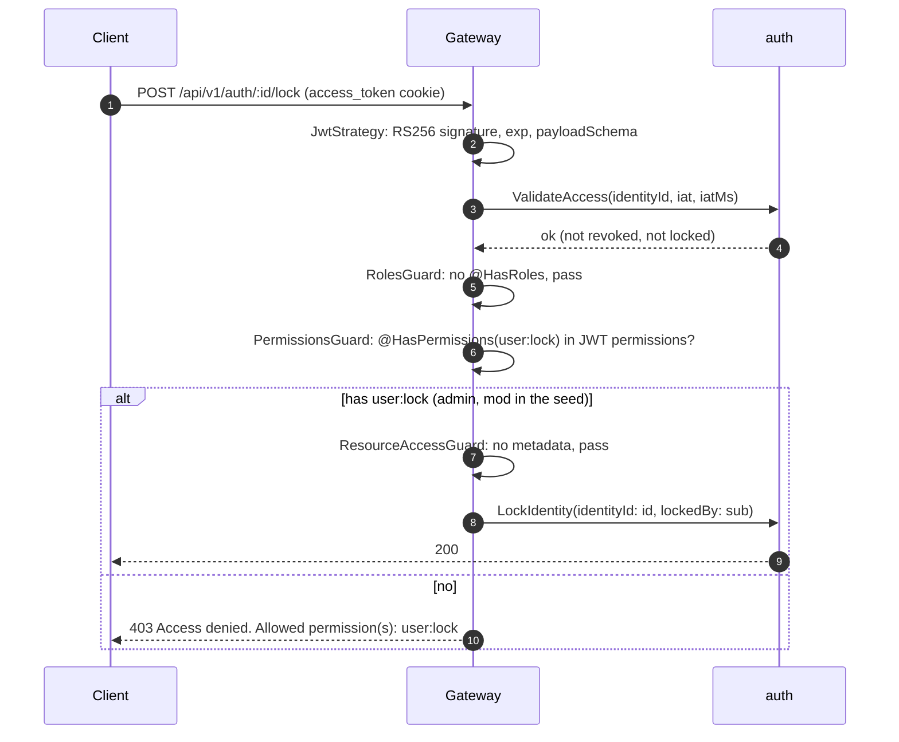
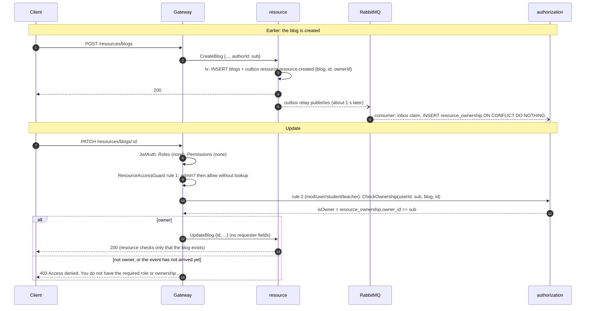
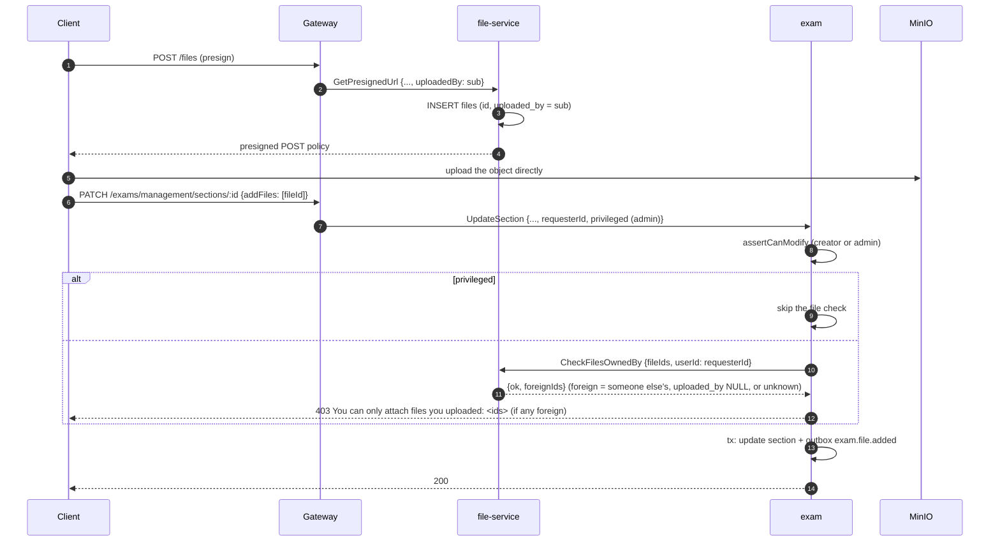

# Authentication and authorization

How the backend decides who you are and what you may do, as the code works **today** (branch `chore/local-dev-fixes`). Sections 1 and 2 are the 10-minute version. Section 3 traces one request per mechanism. Sections 4 to 6 are reference. Per-route detail lives in [flows/](README.md#operation-flows); token and session flows in [flows/auth.md](flows/auth.md).

## 1. In short

Every HTTP request enters through the gateway. The gateway checks the JWT (signature, expiry, not revoked, account not locked), and then one of **three mechanisms** decides whether the caller may do the thing:

1. **Role/permission check in the gateway.** The JWT carries the caller's `roles` and `permissions`. A route marked `@HasRoles(...)` or `@HasPermissions(...)` is refused with 403 if the token has none of them. Nothing else is looked up. Good for "only admins may list users".
2. **`@ResourceAccess`: ask the authorization service "does this user own this object?"** The authorization service keeps a table of `(resource type, resource id, owner id)`. It fills that table by listening to `*.created` / `*.deleted` events that the owning services publish. The gateway calls `CheckOwnership` before forwarding the request. **Legacy**: only four routes still use it, and AGENTS.md says not to add more.
3. **Requester pattern: the owning service decides from its own rows.** The gateway forwards _who is asking_ (`requesterId` = JWT `sub`, plus `privileged` = "has one of the override roles") inside the gRPC request. The service compares that with its own column (`exams.created_by`, `flash_card_lists.author_id`, `rooms.created_by`, `reports.reported_by`, `files.uploaded_by`, ...) and answers 404 or 403. This is how almost all ownership rules work now.

Mechanisms combine: e.g. live ban first needs `@HasRoles(Mod, Admin)` (1) and then room ownership in live (3).

**Is ownership data pulled into each service's local database?** No. No service pulls from, or caches, the authorization service. That was the plan in the hybrid design (section 2), but it was never built. Each service already _owns_ its ownership column and checks it directly; the authorization service holds an **extra copy** of some of those columns, used only by the `@ResourceAccess` routes. The one place data ever flowed _from_ authorization _into_ a service is a one-off backfill (live's `rooms.created_by`, section 2.2), not a sync.

### Which routes use which

All paths are under `/api/v1`. "Override" is who skips the ownership check (`privileged`).

| Mechanism                    | Routes                                                                                                                                                                                             | Rule                                                                                                                        |
| ---------------------------- | -------------------------------------------------------------------------------------------------------------------------------------------------------------------------------------------------- | --------------------------------------------------------------------------------------------------------------------------- |
| 1 roles                      | `GET /auth/identities`, `/auth/roles`, `/auth/perms`, `/auth/identity/search/phone`, `POST`/`DELETE /auth/:id/roles`, `POST /notifications`                                                        | `@HasRoles(Admin)`                                                                                                          |
| 1 roles                      | `/exams/tags/*`; every `/exams/management/*` route (class level); `POST /chat/rooms`; `PATCH`/`DELETE /resources/reports/:id`; `PATCH /resources/forum/threads/:threadId/moderation`               | `@HasRoles(Mod, Admin)`                                                                                                     |
| 1 permissions                | `POST /auth/:id/lock`, `DELETE /auth/:id/lock`, `PATCH /exams/management/:id/review`                                                                                                               | `@HasPermissions(USER_LOCK / USER_UNLOCK / EXAM_APPROVE)`                                                                   |
| 2 `@ResourceAccess`          | `PATCH`/`DELETE /resources/blogs/:id`                                                                                                                                                              | admin; or mod/user/student/teacher **and** owner of `blog`                                                                  |
| 2 `@ResourceAccess`          | `DELETE /chat/rooms/:roomId`, `PATCH /chat/rooms/:roomId/schedule` (also `@HasRoles(Mod, Admin)`)                                                                                                  | admin; or mod **and** owner of `room`                                                                                       |
| 3 requester                  | exam management: update/delete/move exam, sections, questions                                                                                                                                      | creator (`exams.created_by`) or admin; 403 / 404 missing                                                                    |
| 3 requester                  | flash cards, flash card lists (read, update, delete, add card), copies and proposals (`/resources/flash-card-lists/:id/fork`, `/diff`, `/pull`, `/proposals`, `/resources/flash-card-proposals/*`) | owner of the list or admin; private and not yours = 404                                                                     |
| 3 requester                  | reports: `GET /resources/reports`, `GET /resources/reports/:id`, report files                                                                                                                      | reporter or mod/admin; not yours = 404                                                                                      |
| 3 requester                  | blog comments (`/resources/blogs/:id/comments`, `/resources/blog-comments/:commentId`), forum threads and replies (`/resources/forum/*`)                                                           | edit: author only; delete: author or mod/admin; not yours = 404                                                             |
| 3 requester                  | `POST /chat/rooms/:roomId/ban`, `DELETE /chat/rooms/:roomId/ban/:uid`                                                                                                                              | room owner (`rooms.created_by`) or admin; ownerless rooms admin-only                                                        |
| 3 file attach                | exam section/question `addFiles`, `POST /resources/reports` (`fileIds`), `POST /resources/reports/:id/files`, flash card `imageFileId`, avatar (`POST /auth/my/identity`)                          | file uploaded by you (`files.uploaded_by`), checked with file-service `CheckFilesOwnedBy`; admins skip it except on avatars |
| 3 "own data" (simplest form) | notifications (`recipientId: sub`), preferences, `/auth/my/*`, `/achievements/badges/my*`, exam attempts                                                                                           | the service filters by the id the gateway took from the JWT                                                                 |

The full route list with every guard is in each `flows/*.md` file.

Guard order (global `APP_GUARD`s, `apps/gateway/src/gateway.module.ts`): `ThrottlerGuard` → `JwtAuthGuard` → `RolesGuard` → `PermissionsGuard` → `ResourceAccessGuard`; route-level `@UseGuards(...)` such as `CookieIssuanceGuard` run after them. `@IsPublic()` skips all four auth guards.

## 2. What the design said vs what was built

### 2.1 The plans

Two planning documents (formerly in `docs/superpowers/`, now summarized in [`../roadmap.md`](../roadmap.md#earlier-plans-and-what-became-of-them); full text in git history) describe a target that is **not** what runs:

- **Actor/permission plan** (`plans/2026-11-12-actor-permission-authorization.md`, a pilot on reports): the gateway forwards the caller's JWT in gRPC metadata; each service verifies it itself (`ActorAuthGuard`) and decides from an `Actor { id, permissions }` plus its own rows. `requesterId`/`privileged`, `@HasRoles` and `@ResourceAccess` go away; permissions become `<context>:<resource>:<action>` (e.g. `resource:report:manage`). It also proposed retiring the authorization service.
- **Hybrid authorization design** (`specs/2026-11-12-hybrid-authorization-design.md`, status "agreed in conversation, pending final read-through"). It reverses the "retire authorization" direction. This is the design with local copies:
  - The authorization service becomes the **single source of truth and only writer** of relationships, stored as tuples `(objectType, objectId, relation, subjectType, subjectId)` (only `owner` for now), with an append-only, versioned **change log**.
  - Each service keeps a **local snapshot** (`authz_tuple` + `authz_sync_state`) of the tuples for its own object types, **synced incrementally by version** with `PullChanges(objectTypes, afterVersion)`, bootstrapped with `ExportSnapshot`, nudged by `authz.changed.<objectType>` events, with a 30 s safety poll and catch-up before the service reports ready.
  - **Everyday operations are decided locally** from the snapshot plus JWT permissions (fast, no network hop) and written to a local audit log. Policies join `authz_tuple`; columns like `authorId` become display-only.
  - **Deleting a top-level object** (blog, list, report, exam, room) goes gateway → authorization `DeleteResource`, two-phase (`pending_delete`, compensation on failure, 204 within 5 s or 202 + operation id). The owning service only applies it by consuming an event.
  - Creation publishes `authz.ownership.register` through the outbox and writes a provisional local tuple so the creator isn't blocked.
  - Rollout: (1) observability and health, (2) outbox/inbox, (3) authorization tuples + change log + sync API, (4) resource pilot, (5) exam and live, (6) remove the legacy paths.

### 2.2 What exists

| Hybrid design element                                                               | In the code?                                                                                                                                                                                                                                          |
| ----------------------------------------------------------------------------------- | ----------------------------------------------------------------------------------------------------------------------------------------------------------------------------------------------------------------------------------------------------- |
| Step 1: observability, `/health/live` + `/health/ready`                             | **Yes** (`@server/telemetry`, Grafana LGTM). `ReadinessRegistry` can take an extra readiness check (its tests use the name `authz-catchup`), but no app registers one. The "Authz sync health" dashboard is listed as "later" (`docs/operations.md`). |
| Step 2: outbox/inbox in every service, event envelope                               | **Yes** (`@server/messaging`), plus retry queues and DLQs                                                                                                                                                                                             |
| Step 3: tuples, change log, `PullChanges`/`ExportSnapshot`/`Check`/`DeleteResource` | **No.** `proto/authorization.proto` has one RPC, `CheckOwnership`. The only table is `resource_ownership`.                                                                                                                                            |
| Local snapshots in services (`authz_tuple`, `authz_sync_state`), sync loop          | **No.** No service has such a table, and nothing outside the gateway calls the authorization service (`grep -ri authz apps libs proto` finds only that test).                                                                                         |
| `Actor`, `ActorAuthGuard`, JWT forwarded to services                                | **No.** Services trust `requesterId`/`privileged` in the request message.                                                                                                                                                                             |
| Sensitive deletes through authorization                                             | **No.** Every delete goes to the owning service.                                                                                                                                                                                                      |
| Retire `@ResourceAccess`                                                            | **Partly**: removed from exams (`e71f80c`) and flash cards (`c89d5dc`); still on blogs and room delete/schedule                                                                                                                                       |
| Retire `requesterId`/`privileged`, `@HasRoles`, the shared `Permission` enum        | **No**: the requester pattern is now the main mechanism                                                                                                                                                                                               |

So, today:

- **Ownership lives in the owning service's own tables** (`exams.created_by`, `blogs.author_id`, `flash_card_lists.author_id`, `reports.reported_by`, forum and comment `author_id`, `rooms.created_by`, `files.uploaded_by`), and those services check it themselves (mechanism 3).
- **The authorization service is an event-fed copy** (`resource_ownership`) of some of those columns. Consumers: `exam.exam.created/deleted`, `live.room.created/deleted`, `resource.resource.created/deleted` (types `blog` and `flashcard`). Only the four `@ResourceAccess` routes read it (`blog` and `room` rows). The `exam` and `flashcard` rows are still written and seeded, but nothing reads them.
- **Blog and room ownership is stored twice.** resource has `blogs.author_id` and live has `rooms.created_by`, but `UpdateBlog`/`DeleteBlog` and `RemoveRoom`/`UpdateRoomSchedule` don't check them; the gateway relies on the authorization copy instead. Room ban/unban, on the other hand, checks live's own column. So one room is authorized from two sources depending on the route.
- **live's `rooms.created_by` is the closest thing to "pull into local db", and it is a one-off.** It was added in `aaa6100` (S12, "only the room owner or an admin may ban/unban") because live had no owner column. New rooms get it from `req.user.sub` at creation, inside live. Older rooms were filled by `apps/authorization/prisma/seed.ts`, which copies `resource_ownership` owners into `live.rooms.created_by` where it is empty (and then copies live's owners back into `resource_ownership`). That runs only when someone runs `prisma:seed`. No consumer or poller keeps it in sync, and none is needed: live writes the column itself from then on.

### 2.3 Why it ended up like this

From the commit history (`git log -- apps/authorization docs/architecture/authorization.md`) and the plans:

1. The hybrid design was written on 2026-11-12 (`b2468e6`). The same day, the backlog plan (`plans/2026-11-12-backlog-goal.md`) had security bugs to close: S2 (any mod could edit any exam) and S12 (any mod could ban in any room). It kept the hybrid design as "the target architecture", but fixed these with the existing requester pattern (`requesterOf(...)`, the service checks `createdBy`), because the owning services already had, or could cheaply add, an owner column. That needed no new infrastructure and no wait for event delivery.
2. Hybrid rollout steps 1 and 2 (observability, outbox/inbox) were built because the whole system needed them anyway. Step 3, the authorization tuples and sync API, was never started. The Restate spec (`specs/2026-11-12-restate-adoption-design.md`, decision D5) also says the delete saga (hybrid §6.3) should wait until it is decided whether to build it on Restate.
3. `@ResourceAccess` kept causing the very problem the hybrid design describes: the copy is eventually consistent, so a creator got 403 on their own new object until the event arrived, and a lost event locked them out. Flash cards were moved off it for that reason (`c89d5dc`: "A new card is no longer 403 for its author until resource.resource.created is consumed"). Instead of adding a sync, the check moved to the column the service already had.
4. AGENTS.md made this the convention: "Don't add new `@ResourceAccess` routes; prefer the requester pattern", and "rules that depend on the data itself are enforced in the owning service".

The result is that the owner's observation is right: today's ownership checking is the same idea as before (compare the caller with the object's owner), just done in the service that owns the row instead of through the authorization copy.

### 2.4 Two ways to finish (options, not decisions)

**Option A: drop the authorization copy (finish the requester direction).**

1. Move `PATCH`/`DELETE /resources/blogs/:id` to the requester pattern: add `requester_id`/`privileged` to `UpdateBlogRequest`/`DeleteBlogRequest`, check `blogs.author_id` in `BlogService` (admin override; decide whether mods keep their own-blog rights, as today, or get an override).
2. Move `DELETE /chat/rooms/:roomId` and `PATCH .../schedule` the same way, reusing `ChatService.assertCanModerate` (owner or admin, ownerless rooms admin-only). Run the authorization seed once more first, so no room that has an owner row in `resource_ownership` still has `created_by NULL`.
3. Then remove `ResourceAccessGuard`, `@ResourceAccess`, the gateway's `AUTHORIZATION_CLIENT`, the ownership consumers, and either the whole `apps/authorization` service or keep it as an empty shell. The `exam.exam.*`, `live.room.*`, `resource.resource.*` events then have no consumer (nothing else subscribes to them today) and can be dropped too.
4. Separate decision, still open either way: services trust `requesterId`/`privileged` from the message (section 6.4). The Actor step (forward the JWT, verify it in each service) is what would close that.

**Option B: build the hybrid design (central truth + local replicas).**

1. Authorization: `relation_tuple` + `change_log` (migrated from `resource_ownership`, backfilled from the services' own owner columns), RPCs `PullChanges`, `ExportSnapshot`, `Check`, `authz.changed.*` nudges.
2. Each service: `authz_tuple` + `authz_sync_state` tables, a sync worker (startup catch-up registered in `ReadinessRegistry`, nudge consumer, 30 s poll), sync metrics and the "Authz sync health" dashboard and alerts.
3. Rewrite every requester-pattern check to read the snapshot instead of `created_by`/`author_id`; creation publishes `authz.ownership.register` and writes a provisional tuple.
4. Sensitive deletes through `DeleteResource` (decide Restate or not first, D5). Add Actor/JWT forwarding.
5. That is a new subsystem in every service. What it buys over option A: one place that knows all ownership (needed for future groups/sharing or cross-service rules), and a committed central record before irreversible deletes. Today no feature needs either: every rule only looks at data its own service already holds.

## 3. Request walkthroughs

### 3.1 Role/permission only: `POST /api/v1/auth/:id/lock`



No database lookup decides the permission: it is whatever was in the JWT when it was issued. That is why a role change revokes the user's tokens (section 4).

### 3.2 `@ResourceAccess`: `PATCH /api/v1/resources/blogs/:id`

<a id="5-legacy-resourceaccess-and-the-authorization-service"></a>



Facts worth knowing (`apps/gateway/src/auth/guards/resource-access.guard.ts`, `apps/authorization/`):

- Rules are tried in order. A rule is skipped if the user has none of its roles; a rule without `requireOwnership` allows immediately. A `parent` or `mentor` matches no blog rule, so gets 403 even on their own blog.
- `registerOwnership` is `createMany(..., skipDuplicates)`: the first owner wins, so a replayed or forged "created" event can't transfer ownership. The seed, however, upserts with the owner from the service's column.
- The copy is eventually consistent (403 right after create) and has no repair path except re-running `apps/authorization/prisma/seed.ts`, which re-copies `exams.created_by`, `blogs.author_id`, `flash_cards.author_id` and `live.rooms.created_by`.
- Room delete/schedule work the same way with `resourceType: 'room'`; live's `RemoveRoom`/`UpdateRoomSchedule` don't check `rooms.created_by`.

### 3.3 Requester pattern: `PATCH /api/v1/exams/management/:id`

<a id="6-requester-pattern-authorization-in-the-owning-service"></a><a id="a-updating-an-exam-patch-apiv1examsmanagementid"></a>

```mermaid
sequenceDiagram
  autonumber
  participant C as Client
  participant G as Gateway
  participant E as exam
  participant DB as exam_db

  C->>G: PATCH /exams/management/:id
  G->>G: JwtAuth; RolesGuard: class-level @HasRoles(Mod, Admin)
  Note right of G: teacher, user, ... get 403 here
  G->>E: UpdateExam {...body, id, requesterId: sub, privileged: hasAnyRole(user, [Admin])}
  E->>DB: getExamCreator(examId) = exams.created_by
  alt no such exam
    E-->>C: 404 Exam not found
  else not privileged and created_by != requesterId
    E-->>C: 403 Only the exam creator or an admin can modify this exam
  else creator or admin
    E->>DB: UpdateExamCommand
    E-->>C: 200
  end
```

`requesterOf(user, roles)` (`apps/gateway/src/auth/functions/requester.ts`) builds `{ requesterId: user.sub, privileged: hasAnyRole(user, roles) }`, always from the verified JWT and never from the body or query. The check is `ExamManagementController.assertCanModify` (`apps/exam/src/presentation/controllers/exam-management.controller.ts`). Sections and questions resolve to their exam; moves also check the destination. A `ForbiddenException` crosses gRPC as `PERMISSION_DENIED` and comes back as HTTP 403 (`libs/utils/src/filters/`).

<a id="d-live-ban--unban-post-apiv1chatroomsroomidban-delete-apiv1chatroomsroomidbanuid"></a>

Same shape, different details:

| Route                                       | Gateway sends                                              | Service check                                                                                                    | "Not yours"                                         |
| ------------------------------------------- | ---------------------------------------------------------- | ---------------------------------------------------------------------------------------------------------------- | --------------------------------------------------- |
| `PATCH`/`DELETE /resources/flash-cards/:id` | `requesterOf(user, [Admin])`                               | `FlashcardService.findOwnedCard`: `flash_cards WHERE id AND list.author_id = requesterId` (no filter for admins) | **404** `FlashCard not found` (private data)        |
| `GET /resources/reports/:id`                | `requesterOf(user, [Mod, Admin])`                          | `ReportService.findVisibleReport`: `reported_by = requesterId` unless privileged                                 | **404** `Report not found`                          |
| `POST /chat/rooms/:roomId/ban`, unban       | `requesterOf(user, [Admin])` after `@HasRoles(Mod, Admin)` | `ChatService.assertCanModerate`: `rooms.created_by` of a non-deleted room                                        | **403**; ownerless room: 403 for mods; missing: 404 |

Status rule: "you can't see this" is 404, the same answer as for an id that doesn't exist, so ids of private data don't leak. "You can see it but not change it" is 403 (exam content, someone else's public list, live moderation, foreign files).

### 3.4 File attach: `PATCH /api/v1/exams/management/sections/:id` with `addFiles`



| Attach point                             | Check                                                 | Override                                                                        |
| ---------------------------------------- | ----------------------------------------------------- | ------------------------------------------------------------------------------- |
| Exam section/question `addFiles`         | `ExamManagementController.assertCanAttach`            | admin (`privileged`)                                                            |
| `POST /resources/reports` (`fileIds`)    | `ReportService.createReport` → `assertOwnedBy`        | `mayAttachAnyFile` (admin)                                                      |
| `POST /resources/reports/:id/files`      | `ReportService.addFileToReport`                       | `mayAttachAnyFile` (admin; mods see all reports but can't attach foreign files) |
| Flash card `imageFileId` (create/update) | `FlashcardService` → `assertOwnedBy`                  | `mayAttachAnyFile` (admin); re-sending the card's current image is no change    |
| Avatar (`POST /auth/my/identity`)        | `UpdateIdentityHandler`, only when `avatarId` changes | none                                                                            |

Viewing files is not restricted by uploader. Files from before `uploaded_by` existed can only be attached by admins (where an admin override exists).

## 4. Tokens and sessions

Detail and every route: [flows/auth.md](flows/auth.md). The short version:

- **JWT, RS256.** auth signs with `JWT_PRIVATE_KEY`; gateway and live verify with `JWT_PUBLIC_KEY`. Access token (default 15 min): `sub`, `roles[]`, `permissions[]`, `typ: ACCESS`, `jti`, `iat`, `iatMs`, `exp`. Refresh token (default 7 days): `sub`, `typ: REFRESH`, `jti`, `fam` (rotation family), `iat`, `iatMs`, `exp`, and no roles or permissions. `typ` keeps one kind from being used as the other (`libs/utils/src/types/payload.type.ts`).
- **Verification in the gateway** (`JwtStrategy`): token from the `access_token` cookie, else `Authorization: Bearer`; signature and expiry; `payloadSchema`; then gRPC `auth.ValidateAccess`, which rejects revoked tokens (401) and locked accounts (403). `req.user = { sub, roles, permissions }`. live verifies its own socket handshakes the same way.
- **Cookies** (`apps/gateway/src/auth-gateway/auth-cookies.ts`): `access_token` (`Path=/`) and `refresh_token` (`Path=/api/v1/auth`), HttpOnly, `SameSite=Lax`, `Secure` on HTTPS or in production, `Max-Age` from each token's `exp`. Login, register, refresh and `POST /auth/google/tokens` set them and return `data: null`; tokens never appear in a body. Those routes carry `CookieIssuanceGuard` (403 on `Sec-Fetch-Site: cross-site` or a foreign `Origin`). The browser only talks to the frontend origin, which proxies `/api/*`, so the cookies are first-party.
- **Refresh rotation with reuse detection** (`TokenService.rotateTokens`): each refresh token works once (`auth:refresh:used:<jti>`, `SET NX`). Presenting it again within 30 s (tabs refreshing at once) returns the same successor; later it counts as stolen and revokes its whole family (`auth:refresh:family:<fam>:revoked`). Refresh re-reads roles and permissions from the database.
- **Revocation**: `revokeUser` stores a timestamp in `jwt:blacklist:user:<id>`; every token with `iatMs` at or before it is rejected. Called by `logout-all`, password change, and role assign/remove (so new roles take effect at the next login). Locking does not revoke but `ValidateAccess` refuses locked accounts on every request, and live closes their sockets. Plain `logout` only clears cookies.
- **Google OAuth**: the start route stores a single-use nonce in Redis and sets the `oauth2_state` cookie (`Path=/api/v1/auth/google/callback`, 300 s); the callback requires cookie == state. The callback hands the frontend a 60 s one-time `loginToken`, exchanged at `POST /auth/google/tokens` for the cookies. Linking a Google account is a top-level navigation to `/auth/credentials/google` so it carries the session cookie.

## 5. Roles and permissions

- **Defined in code**: `Role` (`admin`, `mod`, `user`, `student`, `parent`, `teacher`, `mentor`) in `libs/typing/src/enums/role.enum.ts`, `Permission` (`exam:write`, `user:lock`, ...) in `libs/typing/src/enums/permission.enum.ts`.
- **Stored in auth's database**: tables `roles`, `permissions`, `roles_permissions`, `identity_roles`. `apps/auth/prisma/seed.ts` creates one row per enum value and links them with its `rolePermissions` map: admin gets every permission; mod gets `exam:write`, `exam:review`, `user:lock`, `booking:view-all`, `payment:read`; teacher and mentor get teaching permissions; `user` gets none.
- **Into the JWT**: on login, register, Google login and refresh, `IdentityRepository.getClaimsOfId` joins identity → roles → permissions and the token is signed with both lists. Nothing else reads these tables per request.
- **Admin routes**: `POST`/`DELETE /auth/:id/roles` change a user's roles and revoke their tokens.

**Adding a permission:**

1. Add it to the `Permission` enum (`@server/typing`). It must be there: auth's `parseEnum` and the gateway's `payloadSchema` reject unknown values.
2. Grant it to roles in `rolePermissions` in `apps/auth/prisma/seed.ts` and run `nx run auth:prisma:seed`. The seed only adds rows; removing a grant needs a manual delete or a migration.
3. Use it with `@HasPermissions(Permission.X)` on gateway routes. Users get it with their next token (log in again, or refresh).

## 6. Reference

### 6.1 Decorators and helpers (`apps/gateway/src/auth/`)

| Name                                                        | Effect                                                                                                              |
| ----------------------------------------------------------- | ------------------------------------------------------------------------------------------------------------------- |
| `@IsPublic()`                                               | Skips `JwtAuthGuard`, `RolesGuard`, `PermissionsGuard`, `ResourceAccessGuard`                                       |
| `@HasRoles(...roles)`                                       | `RolesGuard`: any listed role in the JWT, else 403. Handler metadata overrides class metadata (`getAllAndOverride`) |
| `@HasPermissions(...perms)`                                 | `PermissionsGuard`: any listed permission, else 403                                                                 |
| `@ResourceAccess({ resourceType, resourceIdParam, rules })` | `ResourceAccessGuard` → `authorization.CheckOwnership`. Legacy, no new uses                                         |
| `requesterOf(user, roles)`, `hasAnyRole(user, roles)`       | Build `requesterId`/`privileged` (or `mayAttachAnyFile`) for gRPC requests                                          |
| `CookieIssuanceGuard`                                       | Route-level, on routes that set or clear session cookies                                                            |

### 6.2 Status codes

| Situation                             | Code |
| ------------------------------------- | ---- |
| No, invalid, expired or revoked token | 401  |
| Account locked                        | 403  |
| Missing role or permission            | 403  |
| Private data that isn't yours         | 404  |
| Visible but not yours to change       | 403  |

### 6.3 Files

- Gateway: `apps/gateway/src/gateway.module.ts` (guard order), `apps/gateway/src/auth/{guards,decorators,functions}/`, `apps/gateway/src/auth-gateway/strategies/jwt.strategy.ts`, `apps/gateway/src/auth-gateway/auth-cookies.ts`.
- auth: `apps/auth/src/app/services/token.service.ts` (signing, rotation, revocation), `apps/auth/src/app/commands/handlers/validate-access.handler.ts`, `apps/auth/prisma/seed.ts` (roles and permissions).
- authorization: `proto/authorization.proto`, `apps/authorization/prisma/schema/ownership.prisma`, `apps/authorization/src/app/events/handlers/`, `apps/authorization/prisma/seed.ts`. Flows: [flows/achievement-file-authorization.md](flows/achievement-file-authorization.md).
- Requester checks: `apps/exam/src/presentation/controllers/exam-management.controller.ts`, `apps/resource/src/app/services/{flashcard,flashcard-list,flashcard-proposal,flashcard-fork,report,blog-comment,forum}.service.ts`, `apps/live/src/app/services/chat.service.ts`, `apps/*/src/app/services/file-ownership.service.ts`, `apps/file-service/src/app/services/file.service.ts` (`checkFilesOwnedBy`).

### 6.4 Known risks

- **Services trust the request message.** `requesterId`, `privileged`, `mayAttachAnyFile`, `userId`, `recipientId` are plain gRPC fields; the gateway does not forward the JWT. Anything that can reach a service's gRPC port or its Envoy gRPC-web sidecar (published on `127.0.0.1` only since S16) can send `privileged: true`. Closing this is the Actor step (section 2.1), not built.
- `@ResourceAccess` ownership is eventually consistent (403 just after create) and a lost event loses ownership until the authorization seed is re-run.
- `logout` doesn't revoke tokens; `logout-all` does. A socket opened before a logout-all or password change stays open until it disconnects (locks do close sockets).
