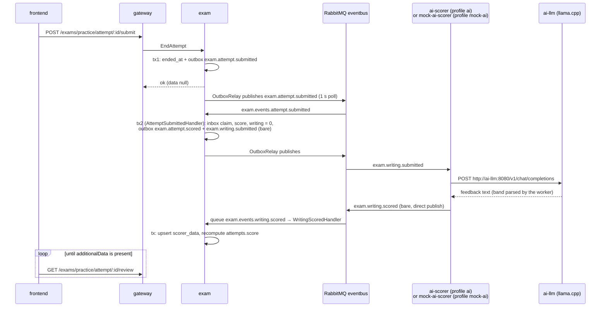

# Exam flows

Every HTTP route the gateway serves under `/api/v1/exams`, traced into `apps/exam`. Gateway controllers: `apps/gateway/src/exam-gateway/{exam-management,exam-practice,tag,goal}.router.controller.ts`, mounted at `/exams` by `apps/gateway/src/router.module.ts` (global prefix `api`, URI version `v1`). All four use one gRPC client (`EXAM_CLIENT`, `exam.router.module.ts`) for the `exam.ExamManagementService`, `exam.ExamPracticeService`, `exam.TagService` and `exam.GoalService` services. Tables and models: [services-and-data.md, exam](../services-and-data.md#exam-appsexam). Outbox, inbox and retry queues: [messaging.md](../messaging.md). Requester pattern: [authorization.md §6](../authorization.md#6-requester-pattern-authorization-in-the-owning-service).

Conventions used below:

- **Status mapping.** Exceptions thrown in exam pass through `GlobalRpcExceptionFilter` (`libs/utils/src/filters/global.rpc.filter.ts`) and come back to HTTP through `rpc-to-http.http.filter.ts`. Two mappings matter here. `MethodNotAllowedException` (405) becomes gRPC `CANCELLED`, which the gateway returns as **499**. Any error that is not a Nest `HttpException` becomes `UNKNOWN`, which the gateway returns as **502**. Examples are Prisma `P2025`/`P2002`/validation errors and raw PostgreSQL exceptions.
- **Exam version lock.** `exams.version` is the optimistic lock for the whole exam tree. Exam, section and question saves update `where { id, version }` and increment it (`apps/exam/src/infra/repositories/{exam,section,question}.prisma.repository.impl.ts`). A stale save fails with Prisma `P2025`, which the gateway returns as **502**, not 409. Exam-tree saves are not retried.
- **Approved is frozen.** `assertModifiable()` in `domain/entities/{exam,section,question}.entity.ts` throws **409** `Exam is already approved and can no longer be updated.` for any content change, and for `updateStatus`, once `status = APPROVED`.
- **Attempt version lock.** `attempts.version` is checked by `updateAtVersion` in `attempt.prisma.repository.impl.ts`, which throws `AttemptVersionConflictException` (409). Practice writes are wrapped in `retryAttemptConflicts` (`apps/exam/src/app/services/attempt-conflict-retry.ts`): up to 6 tries with a 10-60 ms jitter, and each try runs in a fresh `@Transactional()`.
- **Throttling.** The default throttler allows 100/min per IP and signed-in account (`apps/gateway/src/throttle.ts`). `@AnswerThrottle()` raises this to 300/min per IP and account.
- **Validation.** The gateway `ValidationPipe` uses `whitelist: true`, so fields a DTO does not declare are dropped. Spreading `...body` after `uid`/`userId` therefore cannot override the id taken from the JWT.

## Contents

| Operation                                                                                                      | Access                       | Writes                                                                                  | Events                                                                           |
| -------------------------------------------------------------------------------------------------------------- | ---------------------------- | --------------------------------------------------------------------------------------- | -------------------------------------------------------------------------------- |
| [POST /exams/management](#post-apiv1examsmanagement)                                                           | mod, admin                   | `exams`                                                                                 | `exam.exam.created`                                                              |
| [PATCH /exams/management/:id](#patch-apiv1examsmanagementid)                                                   | mod, admin; creator or admin | `exams`, `exam_tags`                                                                    | -                                                                                |
| [DELETE /exams/management/:id](#delete-apiv1examsmanagementid)                                                 | mod, admin; creator or admin | `exams` (cascade tree, attempts), `deleted_files` (trigger)                             | `exam.exam.deleted`; later `exam.files.removed`                                  |
| [PATCH /exams/management/:id/review](#patch-apiv1examsmanagementidreview)                                      | mod, admin + `exam:approve`  | `exams.status`                                                                          | -                                                                                |
| [POST /exams/management/:id/sections](#post-apiv1examsmanagementidsections)                                    | mod, admin; creator or admin | `sections`, `section_closures` (trigger), `exams.version`                               | -                                                                                |
| [POST /exams/management/sections/:id/sections](#post-apiv1examsmanagementsectionsidsections)                   | mod, admin; creator or admin | same                                                                                    | -                                                                                |
| [POST /exams/management/sections/:id/questions](#post-apiv1examsmanagementsectionsidquestions)                 | mod, admin; creator or admin | `questions`, `sections`, `exams.version`                                                | -                                                                                |
| [PATCH /exams/management/sections/:id](#patch-apiv1examsmanagementsectionsid)                                  | mod, admin; creator or admin | `sections`, `section_tags`, `section_files`, `deleted_files`                            | `exam.file.added` per added file                                                 |
| [PATCH /exams/management/questions/:id](#patch-apiv1examsmanagementquestionsid)                                | mod, admin; creator or admin | `questions`, `choices`, `question_tags`, `question_files`, `deleted_files`              | `exam.file.added` per added file                                                 |
| [DELETE /exams/management/sections/:id](#delete-apiv1examsmanagementsectionsid)                                | mod, admin; creator or admin | `sections` (cascade), `deleted_files`                                                   | later `exam.files.removed`                                                       |
| [DELETE /exams/management/questions/:id](#delete-apiv1examsmanagementquestionsid)                              | mod, admin; creator or admin | `questions` (cascade), `deleted_files`                                                  | later `exam.files.removed`                                                       |
| [PATCH /exams/management/sections/:id/move](#patch-apiv1examsmanagementsectionsidmove)                         | mod, admin; creator or admin | `sections`, `section_closures`                                                          | -                                                                                |
| [PATCH /exams/management/questions/:id/move](#patch-apiv1examsmanagementquestionsidmove)                       | mod, admin; creator or admin | `questions`                                                                             | -                                                                                |
| [GET /exams/management/exams](#get-apiv1examsmanagementexams) and 4 more management reads                      | mod, admin                   | -                                                                                       | -                                                                                |
| [POST /exams/practice/new/:id](#post-apiv1examspracticenewid)                                                  | signed in                    | `attempts`, `attempt_sections`                                                          | -                                                                                |
| [POST /exams/practice/attempt/:id/answers/:questionId](#post-apiv1examspracticeattemptidanswersquestionid)     | owner, 300/min               | `attempt_responses`, `attempts.version`                                                 | -                                                                                |
| [DELETE /exams/practice/attempt/:id/answers/:questionId](#delete-apiv1examspracticeattemptidanswersquestionid) | owner, 300/min               | same                                                                                    | -                                                                                |
| [PATCH …/answers/:questionId/flag](#patch-apiv1examspracticeattemptidanswersquestionidflag)                    | owner, 300/min               | same                                                                                    | -                                                                                |
| [PATCH …/answers/:questionId/note](#patch-apiv1examspracticeattemptidanswersquestionidnote)                    | owner, 300/min               | same                                                                                    | -                                                                                |
| [POST /exams/practice/attempt/:id/submit](#post-apiv1examspracticeattemptidsubmit)                             | owner                        | `attempts.ended_at`; then `attempts.score/total_points`, `attempt_responses.is_correct` | `exam.attempt.submitted`, `exam.attempt.scored`, `exam.writing.submitted` (bare) |
| [Writing round trip](#writing-scoring-round-trip)                                                              | -                            | `scorer_data`, `attempts.score`                                                         | `exam.writing.submitted` → `exam.writing.scored`                                 |
| [GET /exams/practice/attempt/:id/saved](#get-apiv1examspracticeattemptidsaved)                                 | owner                        | -                                                                                       | -                                                                                |
| [GET /exams/practice/attempt/:id/review](#get-apiv1examspracticeattemptidreview)                               | owner                        | -                                                                                       | -                                                                                |
| [Public catalogue reads](#public-catalogue-reads) (4 routes)                                                   | public                       | -                                                                                       | -                                                                                |
| [`my/*` reads](#my-reads) (5 routes)                                                                           | signed in, own data          | -                                                                                       | -                                                                                |
| [Tags](#tags-tagrouter) (6 routes)                                                                             | mod, admin; 2 reads public   | `tags`, `tags_table_lock`                                                               | -                                                                                |
| [Goals](#goals-goalrouter) (4 routes)                                                                          | signed in, own goal          | `goals`                                                                                 | -                                                                                |
| [Background work](#background-work)                                                                            | -                            | `deleted_files`, `scorer_data`, outbox                                                  | `exam.files.removed`, consumer of `exam.writing.scored`                          |

## Exam management (`ExamManagementGatewayController`)

`@Controller('management')`, so routes live under `/api/v1/exams/management`. The class-level `@HasRoles(Role.Mod, Role.Admin)` is checked by `RolesGuard` in the gateway: a `teacher` gets 403 before any gRPC call. Service side: `ExamManagementController` (`apps/exam/src/presentation/controllers/exam-management.controller.ts`).

Mutations other than create and review send `requesterOf(req.user, [Role.Admin])` (`apps/gateway/src/auth/functions/requester.ts`). The service then runs `assertCanModify(target, who)`:

1. `managementReadRepository.getExamCreator` (`apps/exam/src/infra/repositories/management.read.prisma.repository.impl.ts:110`) resolves the target's `exams.created_by`. The target is an exam, a section (via `section → exam`) or a question (via `question → section → exam`).
2. A missing target gives **404** `Exam not found`.
3. A requester who is neither the creator nor privileged gets **403**.

Unlike private data, "not yours" is 403 here (see [authorization.md §7a](../authorization.md#a-updating-an-exam-patch-apiv1examsmanagementid)).

### POST /api/v1/exams/management

Creates an exam in `PENDING`.

- **Access**: mod or admin. No creator check.
- **Flow**:
  1. Gateway `createExam` validates `CreateExamDto` (`title`, `description` strings; `duration` positive integer, in seconds) and calls `ExamManagementService/CreateExam` with `createdBy: req.user.sub`.
  2. `CreateExamHandler` (`apps/exam/src/app/commands/handlers/management/create-exam.handler.ts`, `@Transactional()`) builds an `Exam` with `status: PENDING`. `ExamPrismaRepositoryImpl.save` inserts the `exams` row with `version: 1`.
  3. Still in the same transaction, it writes outbox `exam.exam.created` (envelope) with `{ resourceType: 'exam', resourceId, ownerId }`.
  4. Response: `CreatedExamDto { id }`.
- **Async**: `exam.exam.created` → queue `authorization.events.exam.created` → `apps/authorization/src/app/events/handlers/exam-ownership.handler.ts` registers the ownership row (inbox: yes).

### PATCH /api/v1/exams/management/:id

Updates title, duration, description and exam tags.

- **Access**: mod or admin, then creator or admin (`assertCanModify({ examId })`).
- **Flow**:
  1. Gateway validates `UpdateExamDto`: `addTags`/`removeTags` are unique arrays of tag **ids**; `setDescriptionNull` clears the description.
  2. `UpdateExamHandler` (`update-exam.handler.ts`, no `@Transactional`; `save` opens its own `withTransaction`) loads the exam and calls `exam.updateDetails` (409 if approved; 400 for a non-positive or non-integer duration), then `addTag`/`removeTag` for each id. A duplicate tag gives 409 and a missing link 404.
  3. `ExamPrismaRepositoryImpl.save` runs a versioned update of `exams` and creates or deletes `exam_tags`. An unknown tag id hits FK `P2003`, which `insertTagLink` (`infra/repositories/tag-link.ts`) turns into 404 `Tag not found`.
  4. The handler then publishes the domain events on the in-process `EventBus`. No handler is registered for them, so they have no effect.
- **Errors**: 404, 403, 409 (approved, or duplicate tag), 502 on a stale version.

### DELETE /api/v1/exams/management/:id

- **Access**: mod or admin, then creator or admin.
- **Flow**:
  1. `DeleteExamHandler` (`delete-exam.handler.ts`, `@Transactional()`) runs `findOne` and then `exams.delete where { id, version }`. The delete cascades to `sections`, `questions`, `choices`, `section_files`/`question_files`, tag links, and also to **`attempts`** with their responses and `scorer_data`.
  2. The `AFTER DELETE` triggers on `section_files`/`question_files` (`apps/exam/src/sql/trg_file_delete.sql`) upsert `deleted_files(file_id, count + 1)`.
  3. In the same transaction it writes outbox `exam.exam.deleted` (envelope) with `{ resourceId }`.
- **Async**:
  - `exam.exam.deleted` → `authorization.events.exam.deleted` → `exam-ownership.handler.ts` removes the ownership row (inbox: yes).
  - The `deleted_files` rows go out within about 60 s as `exam.files.removed` (see [Background work](#publish-deleted-files-bullmq)).
- **Errors**: there is no approved-status check, so approved exams, and every user's attempt history on them, can be deleted.

### PATCH /api/v1/exams/management/:id/review

Sets `status` (approve, reject, or back to pending).

- **Access**: mod or admin **and** `@HasPermissions(Permission.EXAM_APPROVE)`, which only admins hold in the seed. No requester fields are sent and there is no creator check.
- **Flow**:
  1. The gateway `ReviewExamDto.status` is a free string.
  2. The service `ReviewExamDto` (`apps/exam/src/presentation/dtos/req/management/review-exam.req.dto.ts`) checks `@IsEnum(ExamStatus)`, so a bad value gives 400.
  3. `ReviewExamHandler` calls `exam.updateStatus` (409 if already approved) and saves with a versioned update.
- **Errors**: once `APPROVED`, an exam can never be rejected or edited again through the API (`assertModifiable` in `updateStatus`).

### POST /api/v1/exams/management/:id/sections

Creates a top-level section in an exam.

- **Access**: creator or admin (`assertCanModify({ examId })`).
- **Flow**:
  1. `CreateSectionHandler.createExamSection` (`create-section.handler.ts`) runs `exam.createSection(index)` (409 if approved; the order position comes from `domain/entities/order-position.ts`).
  2. `ExamPrismaRepositoryImpl.save`, in one transaction, runs the versioned `exams` update and inserts the `sections` row.
  3. The trigger `trg_section_closure_insert.sql` fills `section_closures`.
  4. Response: `CreatedSectionDto { id }`.

### POST /api/v1/exams/management/sections/:id/sections

Creates a nested section.

- **Access**: creator or admin (`assertCanModify({ sectionId })`).
- **Flow**:
  1. `CreateSectionHandler.createNestedSection` runs `section.createSection(index)`. It returns 409 if the parent's `content_type` is `QUESTION` or the exam is approved.
  2. `SectionPrismaRepositoryImpl.save`, in one transaction, inserts the child section, updates the parent `sections` row with `where exam.version = loaded`, and increments `exams.version`.
  3. Response: `CreatedSectionDto`.

### POST /api/v1/exams/management/sections/:id/questions

- **Access**: creator or admin.
- **Flow**:
  1. `CreateQuestionHandler` runs `section.createQuestion(index)`. It returns 409 if the section holds sections or the exam is approved.
  2. `SectionPrismaRepositoryImpl.save` inserts the `questions` row (default type `MCQ`) and bumps `exams.version`.
  3. Response: `CreatedQuestionDto { id }`.

### PATCH /api/v1/exams/management/sections/:id

Updates name, directive and content type, plus tags and files.

- **Access**: creator or admin. Then `assertCanAttach(addFiles)`:
  - non-privileged requesters go through `FileOwnershipService.assertOwnedBy` (`apps/exam/src/app/services/file-ownership.service.ts`), which calls gRPC `file.FileService/CheckFilesOwnedBy`;
  - files the requester did not upload give **403** listing the foreign ids;
  - admins skip the check.
- **Flow**:
  1. `UpdateSectionHandler` (`update-section.handler.ts`, `@Transactional()`) runs `section.updateDetails`. It returns 409 if the exam is approved, or if `contentType` changes while the section has children.
  2. It then applies `addTag`/`removeTag` and `addFile`/`removeFile`. A duplicate gives 409 and a missing item 404.
  3. `SectionPrismaRepositoryImpl.save` writes `section_tags` and `section_files`, then the section row and the `exams.version` bump.
  4. Deleting a `section_files` row fires the `deleted_files` trigger.
  5. `FileAddedPublisher.publish` (`app/events/publishers/file-added.publisher.ts`) writes outbox `exam.file.added` `{ fileId }` (envelope) for each added file, in the same transaction.
- **Async**:
  - `exam.file.added` → `file.events.file.added` → `apps/file-service/src/app/events/handlers/file-added.handler.ts` runs `incrementRef` (inbox: yes).
  - Removed files reach file-service later as `exam.files.removed`.

### PATCH /api/v1/exams/management/questions/:id

Updates content, explanation, points, type, choices, tags and files.

- **Access**: creator or admin, then the same `assertCanAttach(addFiles)` as sections.
- **Flow**:
  1. The gateway `UpdateQuestionDto.type` is a free string. The service DTO checks `@IsEnum(QuestionType)` (`MCQ`, `MCQ_MULTI`, `Fill`, `FillAny`, `Writing`).
  2. `UpdateQuestionHandler` (`update-question.handler.ts`, `@Transactional()`) applies, in this order: `updateDetails` (points must be an integer ≥ 0), delete choices, add choices, update choices, tags, files.
  3. It then runs `assertChoicesConsistent()`, which returns 409 when a single-answer type has several correct choices.
  4. `QuestionPrismaRepositoryImpl.save` updates `questions` with `where section.exam.version = loaded`, writes `choices`, `question_tags` and `question_files`, and bumps `exams.version`.
  5. It writes outbox `exam.file.added` for each added file.
- **Async**: as for sections.

### DELETE /api/v1/exams/management/sections/:id

- **Access**: creator or admin.
- **Flow**:
  1. `DeleteSectionHandler` first tries `getParentSectionOfSection`. With a parent section, it runs `parent.removeSection`. With no parent (`NotFoundException`), it falls back to `examRepository.getParentExamOfSection` and `exam.removeSection`.
  2. The save deletes the `sections` row, which cascades to children, questions, files and closures. The file triggers fill `deleted_files`.
  3. The exam version is bumped. There is no `@Transactional` on the handler; the repository `save` has its own transaction.

### DELETE /api/v1/exams/management/questions/:id

- **Access**: creator or admin.
- **Flow**: `DeleteQuestionHandler` runs `getParentSectionOfQuestion` (404 if missing), then `section.removeQuestion`. The save deletes the question (cascade to `choices`, `question_files` → `deleted_files`, responses) and bumps the version.

### PATCH /api/v1/exams/management/sections/:id/move

Body `MoveSectionDto { parentId?, toRoot?, index? }`.

- **Access**: creator or admin of the section's exam and, when `parentId` is set, of the destination (`moveSection` in the controller).
- **Flow**: `MoveSectionHandler` (`move-section.handler.ts`) picks one of three paths.
  - **`parentId` set.** `findOneInTheSameExamAsSection(parentId, id)` returns 404 unless the destination is in the same exam. Then `addSection` emits `ChildSectionMovedEvent` and the `sections.parent_id/order` update is saved.
  - **`toRoot`.** `getParentExamOfSection` → `exam.addSection`.
  - **Otherwise** the section is reordered within its current parent, which is a section or the exam.
  - In every case, `trg_section_closure_update.sql` rewrites `section_closures` when `parent_id` changes. It also refuses a move under the section's own descendant with `RAISE EXCEPTION`, which reaches the client as **502**, not 409.

### PATCH /api/v1/exams/management/questions/:id/move

Body `MoveQuestionDto { sectionId?, index? }`.

- **Access**: creator or admin of the source and, when `sectionId` is set, of the destination.
- **Flow**:
  - **`sectionId` set.** `MoveQuestionHandler` loads the destination with `findOneInTheSameExamAsQuestion` (404 if it is in another exam), then `section.addQuestion` (409 if that section holds sections).
  - **Otherwise** `moveChild` reorders the question inside its current section.
  - Saving updates `questions.section_id/order` and bumps the version.

### GET /api/v1/exams/management/exams

Management list with filters `createdBy`, `status`, `title` and created/updated time ranges. Sort is by `updatedAt`/`createdAt`; pagination is by cursor.

- **Access**: mod or admin. No creator filter is applied by default: every mod sees every exam.
- **Flow**:
  1. `FindExamsForManagementHandler` decodes the opaque cursor (`CursorPaginationFactory`, name `FindExamsManagement`). Cursor filter and sort take precedence over the query; `limit` defaults to 10.
  2. It calls `ManagementPrismaRepositoryImpl.findExams`, which reads `exams` with `take: dir * limit`.
  3. Response: `ExamsManagementInfoDto { exams, nextCursor, prevCursor }`.
- **Errors**: `limit` has no upper bound at either the gateway or the service.

### Other management reads

- `GET /api/v1/exams/management/exams/counts`: `GetExamCountsHandler` runs a `groupBy status` on `exams` and returns `ExamCountsDto { total, approved, pending, rejected }`.
- `GET /api/v1/exams/management/exams/:id`: `GetExamManagementDetailsQueryHandler` → `getExamDetail`. Returns `ExamDetailedManagementInfoDto`; 404 if missing.
- `GET /api/v1/exams/management/sections/:id` and `GET /api/v1/exams/management/questions/:id`: the handlers in `app/queries/handlers/management/get-{section,question}-details.handler.ts` read the node with its files. They then call `file.FileService/GetUrls` to swap file ids for presigned URLs. A file-service failure gives **503** `Cannot access File sub-service`. 404 if the node is missing.

All of these are mod/admin only, with no creator check.

## Exam practice (`ExamPracticeGatewayController`)

`@Controller('practice')`, so routes live under `/api/v1/exams/practice`. There is no class-level role: every route needs a signed-in user unless marked `@IsPublic()`.

Attempt routes send `userId: req.user.sub`. `ExamPracticeController.assertOwnAttempt` (`apps/exam/src/presentation/controllers/exam-practice.controller.ts`) reads `attempts.attempted_by` and returns **404** `Attempt not found` for a missing attempt and for someone else's. There is no admin override.

### POST /api/v1/exams/practice/new/:id

Starts an attempt on exam `:id`.

- **Access**: signed in.
- **Flow**:
  1. Gateway `AttemptDto.options` can carry `duration` (positive number, in seconds, no upper bound) and `sectionIds` (top-level section ids).
  2. `AttemptHandler` (`apps/exam/src/app/commands/handlers/practice/attempt.handler.ts`, no `@Transactional`) loads the exam and calls `exam.createAttempt`:
     - **499** if the exam is not `APPROVED` (`MethodNotAllowedException`);
     - **403** if a section id is not a top-level section of this exam;
     - **400** if the duration is ≤ 0;
     - selecting all sections is stored as "no selection";
     - `isStrict` is true only for the full exam at its own duration.
  3. `AttemptPrismaRepositoryImpl.save(AttemptConfig)`:
     - reads the last **finished** attempt's `order` and inserts `attempts` with `order = last + 1`;
     - the unique `(exam_id, attempted_by, order)` turns a second unfinished attempt into `P2002` → `MethodNotAllowedException('Please submit the previous attempt')` → **499**;
     - inserts `attempt_sections` for a partial selection.
  4. `AttemptCreatedEvent` is published on the in-process bus. No handler listens.
  5. Response: `CreatedAttemptDto { id }`.

### POST /api/v1/exams/practice/attempt/:id/answers/:questionId

Autosaves one answer.

- **Access**: owner. `@AnswerThrottle()`: 300/min per IP and account.
- **Flow**:
  1. Gateway `AnswerDto { answer: string }`, with no length limit (writing essays travel here).
  2. `AnswerHandler` runs `retryAttemptConflicts(apply)`, where `apply` is `@Transactional()`.
  3. `AttemptPrismaRepositoryImpl.findOne` loads the attempt, its responses, and the question ids in scope: all questions of the exam, or the descendants of the `attempt_sections` through `section_closures`.
  4. `Attempt.answer` (`apps/exam/src/domain/entities/attempt.entity.ts`) checks:
     - **409** if already submitted;
     - **403** `Exam submission time has expired` after `started_at + duration_limit + 30 s`;
     - **409** if the question is not in this attempt;
     - single-answer types (`MCQ`, `Fill`, `FillAny`, `Writing`) replace the answer, while `MCQ_MULTI` adds to it (**409** on a duplicate option).
  5. `save` runs `updateAtVersion` on `attempts` and creates or updates the `attempt_responses` row.
  6. Response: `data: null`.

### DELETE /api/v1/exams/practice/attempt/:id/answers/:questionId

Removes one option (`RemoveAnswerDto.answer`, sent in a DELETE body) or clears the answer.

- **Access**: owner, 300/min.
- **Flow**: `RemoveAnswerHandler` with retry. `Attempt.deleteAnswer` applies the same submitted and expiry checks, and returns 404 if there is no response or the option is missing. The response row stays, possibly with an empty `answers[]`.

### PATCH /api/v1/exams/practice/attempt/:id/answers/:questionId/flag

- **Access**: owner, 300/min.
- **Flow**: `ToggleFlagHandler` with retry runs `Attempt.toggleFlag`. It creates a response with `is_flagged = true` or flips the existing one. Response: `FlagStateDto { state }`.
- **Errors**: there is no submitted, expiry or question-in-attempt check. Flags can change after submit. An unknown question id fails on the `attempt_responses.question_id` FK, which returns **502**.

### PATCH /api/v1/exams/practice/attempt/:id/answers/:questionId/note

- **Access**: owner, 300/min.
- **Flow**: gateway `AddNoteDto.note` (0-500 chars). `AddNoteHandler` with retry runs `Attempt.addNote`, which upserts `attempt_responses.note`.
- **Errors**: same gaps as flag: no submitted, expiry or question-in-attempt check.

### POST /api/v1/exams/practice/attempt/:id/submit

Ends the attempt and starts scoring. This is the start of the [writing round trip](#writing-scoring-round-trip).

- **Access**: owner.
- **Flow**:
  1. `EndAttemptHandler` (`end-attempt.handler.ts`) runs `retryAttemptConflicts(endAttempt)`, with `endAttempt` as `@Transactional()`:
     - `Attempt.endAttempt()` is idempotent: an attempt that has already ended gives `false`, with no save and no event;
     - it returns **403** `Must at least answer one question before submitting` while time remains and there are no responses (a flag or note counts as a response);
     - after expiry, an empty submit is accepted;
     - it sets `ended_at = now()`.
  2. `save` runs the versioned `attempts` update.
  3. `AttemptSubmittedPublisher` (`app/events/publishers/attempt-submitted.publisher.ts`) writes outbox `exam.attempt.submitted` `{ attemptId, attemptedBy }` (envelope) in the same transaction.
  4. Scoring is asynchronous and durable: the relay publishes `exam.attempt.submitted`, and exam's own consumer `AttemptSubmittedHandler` (`app/events/handlers/attempt-submitted.handler.ts`, queue `exam.events.attempt.submitted`, inbox) scores it. A failure is retried by the broker and dead-lettered, never lost:
     - inside `retryAttemptConflicts`, a `@Transactional()` `score()` claims the event in the inbox, then runs `getScoreEvaluator` and `AttemptEvaluator.evaluateScore()` (`domain/entities/attempt-evaluator.entity.ts`);
     - objective questions: `FillAny` needs any correct key; the other types need the exact set of correct keys, compared case-insensitively;
     - `Writing` questions with no AI band score 0 and raise `WritingSubmittedEvent`;
     - it saves `attempts.score/total_points` (versioned) and `attempt_responses.is_correct`;
     - it writes outbox `exam.attempt.scored` (envelope) and, for each writing answer, `exam.writing.submitted` (**bare**), all in that transaction.
  5. Response: `data: null`. Scoring is not finished when the client receives it.
- **Async**:
  - `exam.attempt.submitted` → `achievement.events.attempt.submitted` → `apps/achievement/src/app/events/handlers/attempt-submitted.handler.ts` updates attempt-count badges (inbox: yes).
  - `exam.attempt.scored` `{ attemptId, attemptedBy, score, totalPoints }` → `achievement.events.attempt.scored` → `attempt-scored.handler.ts` updates score badges (inbox: yes).
  - `exam.writing.submitted` → the AI scorer or the mock (next section).
- **Errors**: if `score()` still fails after the retries, the error is only logged. The attempt then stays unscored and no `.scored` or `.writing.submitted` is sent. This is a known issue in `docs/backlog.md`.

### Writing scoring round trip

1. **Request message.** `WritingSubmittedPublisher` (`apps/exam/src/app/events/publishers/writing-submitted.ts`) builds the snake_case payload with `outbox.add('exam.writing.submitted', message, { bare: true })`:

   | Field          | Source                                                                                                              |
   | -------------- | ------------------------------------------------------------------------------------------------------------------- |
   | `attempt_id`   | the attempt id                                                                                                      |
   | `response_id`  | the response id                                                                                                     |
   | `question`     | the question `content`                                                                                              |
   | `content`      | the answer, read from the DB by `getWritingResponse`                                                                |
   | `exam_type`    | the exam's tag **names** joined with `,`                                                                            |
   | `task_type`    | the question's tag names joined with `,`                                                                            |
   | `target_score` | `goals.target` of the attempt's user, else 0. The goal `type` is ignored (a TOEIC goal is sent as an IELTS target). |

   The AMQP `messageId` is the outbox row id.

2. **Real scorer (`docker compose --profile ai`).** Defined in `docker/docker-compose.app.yaml`.
   - **`ai-llm`**:
     - image `ghcr.io/ggml-org/llama.cpp:server-b12004`;
     - on first start it downloads the GGUF `linhma139/Phi-3-IELTS-Scorer` / `phi-3-mini-4k-instruct.Q4_K_M.gguf` into volume `ai-models`;
     - settings: `--ctx-size 4096`, `--parallel 1`, `--n-predict 512`, `--repeat-penalty 1.1`;
     - limits: 4 GB RAM, `AI_LLM_CPUS` (default 8);
     - health `/health` on 8080, `start_period` 15 min.
   - **`ai-scorer`**:
     - built by `docker/ai-scorer/Dockerfile` from `linhma139/ai-language-evaluator` at `EVALUATOR_REF`, plus `patches/0001-robust-band-parsing.patch`;
     - the build runs the upstream tests, and health is on 8081;
     - env: `LLM_API_URL=http://ai-llm:8080/v1` (the worker appends `/chat/completions`), `LLM_TIMEOUT=600`, `MQ_PREFETCH_COUNT=1`, `MQ_MESSAGE_TTL=3600000`, `MQ_MAX_RETRIES=2`;
     - it consumes `exam.writing.submitted` from its own queue `writing.evaluate` (DLQ `writing.evaluate.dlq`). The worker declares both queues; they are not built with `defineConsumerQueue`, and the queue name comes from the upstream config, not from this repo;
     - essays below the IELTS minimum word counts are banded by rule; others go to the LLM;
     - with the patch (`docker/ai-scorer/patches/README.md`), an answer with no readable band is asked for again up to `LLM_FORMAT_RETRIES` (2) times, then reported as `LLM_PARSE_ERROR` instead of band 0;
     - other failures are re-published to `writing.evaluate` with an `x-retry-count` header, up to `MQ_MAX_RETRIES`;
     - it publishes the bare result `exam.writing.scored` `{ status, attempt_id, response_id, data?: { overall_score, sub_scores, detailed_feedback, corrected_version, corrections? }, error_code?, error_message? }`.

   Mock (`--profile mock-ai`): `apps/mock-ai-scorer/src/app/writing-submitted.handler.ts` consumes from `mock-ai-scorer.writing.submitted`. It waits 2-8 s with the message unacked and publishes random bands with `amqpConnection.publish`, without an outbox. Never run both profiles together.

3. **Result.** `WritingScoredHandler` (`apps/exam/src/app/events/handlers/writing-scored.handler.ts`) consumes `exam.writing.scored` from queue `exam.events.writing.scored` (`WRITING_SCORED_QUEUE`, `apps/exam/src/configs/rmq.sub.config.ts`). See [Background work](#writingscoredhandler).
4. **What the client sees.** Nothing is pushed: there is no notification, SSE or socket for writing results. The frontend polls `GET /api/v1/exams/practice/attempt/:id/review`.
   - `responses[i].additionalData` stays absent until `scorer_data` exists for that response.
   - `totalPoints` and `isCorrect` are absent until the scoring transaction of step 4 has committed (normally within a second or two of the submit).
   - The review does not carry the attempt `score`. The updated score shows up in `GET /exams/practice/my/history`.
   - If scoring fails (`status: 'error'`, or a success without `data`), exam stores the failure as the response's feedback (`{ status: 'error', error_code, error_message, failed_at }`), so `additionalData` appears and the client can stop polling and say the essay was not graded. A later successful result for the response replaces it; a failure never replaces a real band (C21, [fixed-issues.md](../../fixed-issues.md)).

### GET /api/v1/exams/practice/attempt/:id/saved

Resume data for an unfinished attempt.

- **Access**: owner.
- **Flow**:
  1. `GetAttemptDataQueryHandler` (`app/queries/handlers/practice/get-attempt-data.handler.ts`) runs `getAttemptSavedData`. It reads `attempts where ended_at is null`, the responses, and the section tree: the `attempt_sections` descendants through `section_closures`, or every section of the exam. Choices are returned **without** `is_correct`.
  2. If no row matches but the attempt exists, it returns **409** `Attempt already submitted`, so the client can redirect to the review.
  3. File ids are swapped for URLs through `file.FileService/GetUrls` (**503** if that fails).
- Response: `AttemptDataDto`.

### GET /api/v1/exams/practice/attempt/:id/review

The finished attempt with the correct answers.

- **Access**: owner.
- **Flow**:
  1. `GetAttemptReviewQueryHandler` runs `getAttemptReview`, which reads `attempts where ended_at is not null` (404 otherwise), responses with `is_correct` and `scorer_data`, and the section tree with choices **including** `is_correct` and explanations.
  2. Files are swapped for URLs through `GetUrls` (503 if that fails).
- Response: `AttemptReviewDto { startedAt, endedAt, durationLimit, totalPoints?, responses[{ questionId, answers, isCorrect?, isFlagged, note?, additionalData? }], sections }`.
- `additionalData` is `JSON.stringify(scorer_data.comment)`. Because the handler stored `JSON.stringify(payload.data)`, the value is a JSON string inside a JSON string, and the client has to `JSON.parse` it twice.

### Public catalogue reads

All four are `@IsPublic()` and read approved exams only.

- `GET /api/v1/exams/practice`:
  - `FindExamsHandler` (`app/queries/handlers/practice/find-exams.handler.ts`) supports two modes. With `page` (≤ 10 000) it uses offset pages plus `countExams`, returning `totalCount`. Otherwise it uses a cursor (`FindExams`) sorted by `attemptsCount` or `updatedAt`.
  - Filters: `name`, `tags` (any of, descendants match), `requiredTags` (each of).
  - It reads raw SQL over `exams` / `exam_tags` / `tags` with `status = 'APPROVED'`. `limit` has no upper bound.
  - Response: `ExamsInfoDto`.
- `GET /api/v1/exams/practice/info/:id/details`: `getExamDetail` (raw SQL, approved only, 404 otherwise). Returns `ExamDetailDto`.
- `GET /api/v1/exams/practice/info/:id/stats`: `getExamStats`. Average duration and average score percentage over the exam's attempts; approved only. Returns `ExamStatsDto`.
- `GET /api/v1/exams/practice/questions/:id/details`:
  - `getDetailedQuestionInfo` returns the question of an approved exam with `content`, `points`, `type`, **`explanation`** and its ancestor section directives;
  - writing questions have their `#BEGIN_DESCRIPTION…#END_DESCRIPTION` block stripped;
  - files are swapped through `GetUrls` (503 if that fails);
  - response: `QuestionDetailDto`.

### `my/*` reads

All require a signed-in user. `uid` is `req.user.sub`.

- `GET /api/v1/exams/practice/my/calendar?range[from]&range[to]`: `GetUserCalendarQueryHandler` → `getUsersAttemptSummary` over `attempts`. Returns `UserCalendarDto { history }`.
- `GET /api/v1/exams/practice/my/history`:
  - `GetUsersAttemptHistoryHandler` uses cursor pagination. The cursor stores `uid` and is discarded when it differs from the caller.
  - Filters: `examId`. Sort by `endedAt`, `startedAt`, `examId` or `score`. `limit` defaults to 10, with no maximum.
  - Returns `AttemptsHistoryDto`, which includes each attempt's `score`.
- `GET /api/v1/exams/practice/my/stats`: `getUserStats`. Raw SQL over `attempts` (count, average percentage) plus per-tag accuracy over `attempt_responses` ⋈ `questions` ⋈ `question_tags` ⋈ `tags`. Returns `UserStatsDto`.
- `GET /api/v1/exams/practice/my/activity?days`: `GetUserActivityQueryHandler`. `days` is 1-371 (default 182) and is clamped again in the handler. Daily counts and streaks over UTC days from `attempts.ended_at`. Returns `UserActivityDto`.
- `GET /api/v1/exams/practice/my/skills`: `GetUserSkillStatsQueryHandler`. Looks at the latest 100 finished attempts and maps skills through `tag_skills` on exam, section and question tags. Returns `UserSkillStatsDto`.

## Tags (`TagGatewayController`)

`@Controller('tags')`, so routes live under `/api/v1/exams/tags`. Class-level `@HasRoles(Role.Mod, Role.Admin)`; the two reads are `@IsPublic()`. Service: `TagController` → `TagService` → `TagPrismaRepositoryImpl` (`apps/exam/src/infra/repositories/tag.prisma.repository.impl.ts`).

Tags form a nested set (`tags.lft/rgt`). Every structural change runs in one `withTransaction` and first calls `getTableLock()`, a no-op update of the single `tags_table_lock` row. That row lock serializes concurrent tree edits.

- `POST /api/v1/exams/tags`:
  - `AddTagDto { name, parentId? }`;
  - with a parent: shift `rgt ≥ parent.rgt` and `lft > parent.rgt` by 2, then insert at `parent.rgt` (404 `Parent tag not found` if the parent is missing);
  - without a parent: append as a root after the highest `rgt`;
  - response: `AddedTagDto { id }`;
  - a duplicate `name` (unique) gives Prisma `P2002` → **502**.
- `DELETE /api/v1/exams/tags/:id`: deletes the whole subtree (`lft..rgt`) and closes the gap. 404 if missing. The `exam_tags` / `section_tags` / `question_tags` links cascade.
- `POST /api/v1/exams/tags/:id/move`:
  - `MoveTagDto { parentId? }`: moves the subtree as the last child of `parentId`, or to a new root;
  - uses the three-step nested-set move documented in the code;
  - moving a tag into its own subtree gives `MethodNotAllowedException` → **499**; a missing tag or destination gives 404.
- `PATCH /api/v1/exams/tags/:id`: `UpdateTagDto { name }` renames the tag without the table lock. An unknown id (`P2025`) or a duplicate name (`P2002`) gives **502**.
- `GET /api/v1/exams/tags/tree` and `GET /api/v1/exams/tags/list` (public): `TagReadPrismaRepositoryImpl` reads all tags. Returns `TagTreesDto { trees }` and `TagListDto { list }`.

No events are published for tag changes.

## Goals (`GoalGatewayController`)

`@Controller('goals')`, so routes live under `/api/v1/exams/goals`. Signed in only. `uid` is always `req.user.sub`. Service: `GoalController` → `GoalService` → `GoalPrismaRepositoryImpl` (`goals`, PK `uid`, `target Int`).

- `POST /api/v1/exams/goals/my`: `SetGoalDto { date, target: number, type: IELTS|TOEIC|VSTEP|TOEFL }` → `goals.create`. Returns `GoalResDto`. A second call (`P2002`) gives **502**, not 409.
- `PATCH /api/v1/exams/goals/my`: same DTO (all fields required) → `goals.update`. When there is no goal (`P2025`), the result is **502**, not 404.
- `DELETE /api/v1/exams/goals/my`: `goals.delete`. **502** when there is no goal.
- `GET /api/v1/exams/goals/my`: `findUnique`, 404 `Goal not found`.

`goals.target` is the `target_score` sent to the AI scorer (see [round trip](#writing-scoring-round-trip)).

## Background work

### `WritingScoredHandler`

| Field       | Value                                                                                                                                                                                                                        |
| ----------- | ---------------------------------------------------------------------------------------------------------------------------------------------------------------------------------------------------------------------------- |
| Routing key | `exam.writing.scored` on `eventbus`, connection `sub`                                                                                                                                                                        |
| Queue       | `exam.events.writing.scored` (`defineConsumerQueue`; retries `.retry.1..5` at 1-16 s, then `.dlq`)                                                                                                                           |
| Inbox       | **no**. The input is a bare payload; a re-run re-saves the same feedback.                                                                                                                                                    |
| Validation  | parameter type `WritingScoredEvent` (class-validator classes in the same file), via the global `GlobalValidationPipe` (`APP_PIPE` in `exam.module.ts`). Unclear: whether golevelup applies global pipes to `@RabbitPayload`. |
| Tables      | `scorer_data` (upsert by `response_id`, `comment` = `JSON.stringify(payload.data)`, or the failure record), `attempts.score/total_points/version`, `attempt_responses.is_correct`                                            |
| Events out  | none (`recomputeScore` raises none; `exam.attempt.scored` is not re-sent)                                                                                                                                                    |

Flow:

1. `status === 'error'`, `error_code`, `error_message`, or no `data` → `saveFailure`: `saveScoringFailure(response_id, JSON.stringify({ status: 'error', error_code, error_message, failed_at }))` in one transaction, skipped (warning logged) when the response already has a band; the attempt score is not recomputed (an ungraded essay adds no points either way). The message is acked, not retried: the scorer already retried on its side.
2. Otherwise it runs `retryAttemptConflicts` around the `@Transactional()` `saveFeedbackAndRescore`:
   - `saveComment(response_id, …)` returns the attempt id; `attempt_id` from the payload is not used;
   - `getScoreEvaluator` → `AttemptEvaluator.recomputeScore()`. Writing points are `round(points × clamp(overall_score / 9, 0, 1))`, with the band read by `toWritingBand` (`infra/repositories/writing-band.ts`);
   - versioned `save`;
   - if the score changed, outbox `exam.attempt.rescored { attemptId, attemptedBy, previousScore, score, totalPoints }` in the same transaction (`AttemptRescoredPublisher`); achievement moves the attempt between its good/perfect counters (`achievement.events.attempt.rescored`).
3. Two essays of one attempt scored at once conflict on `attempts.version`, and the loser re-runs and sees both feedbacks.

### `AttemptSubmittedHandler`

RabbitMQ consumer of exam's own `exam.attempt.submitted` (queue `exam.events.attempt.submitted`, `defineConsumerQueue`, inbox yes). In one transaction it claims the event, scores the attempt and writes `exam.attempt.scored` and `exam.writing.submitted` to the outbox; errors propagate (retries, then DLQ). See [submit](#post-apiv1examspracticeattemptidsubmit).

### `publish-deleted-files` (BullMQ)

`FilesRemovedScheduler` (`apps/exam/src/app/events/publishers/files-removed.publisher.ts`) adds a repeatable job `publish-deleted-files` to BullMQ queue `exam` (Redis from `configs/bullmq.config.ts`) on startup. The job has fixed `jobId` `publish-deleted-files` and runs every 60 000 ms.

`FilesRemovedPublisher` (`@Processor('exam')`) loops over `publishBatch()` (`@UseCls() @Transactional()`):

1. `getAndRemoveDeletedFileIds(100)` runs `DELETE … FOR UPDATE SKIP LOCKED … RETURNING file_id, count` on `deleted_files`.
2. In the same transaction it writes outbox `exam.files.removed` `{ files: [{ id, count }] }` (envelope).
3. It repeats until a batch comes back empty. A failure rolls back the batch, so the rows stay, and fails the job.

Consumer: `file.events.files.removed` → `apps/file-service/src/app/events/handlers/files-removed.handler.ts` runs `decrementRef` (inbox: yes). `deleted_files` is filled by the `AFTER DELETE` triggers on `section_files`/`question_files` (`apps/exam/src/sql/trg_file_delete.sql`). Any removal counts: `removeFiles`, and section, question or exam deletes through the cascade.

### Outbox relay

exam runs `MessagingModule.forRoot({ serviceName: 'exam', relay: true })` (`apps/exam/src/exam.module.ts`). Its `OutboxRelay` publishes `exam.exam.created/deleted`, `exam.file.added`, `exam.files.removed`, `exam.attempt.submitted/scored` and the bare `exam.writing.submitted` on connection `pub`. See [messaging.md §4](../messaging.md#4-the-relay-outboxrelay).

There are no socket.io or SSE endpoints in exam.

## Findings

1. **Status codes.**
   - `MethodNotAllowedException` reaches clients as **499**: starting an attempt on an unapproved exam, starting a second attempt while one is unfinished (`apps/exam/src/infra/repositories/attempt.prisma.repository.impl.ts:258`), and moving a tag into its own subtree (`apps/exam/src/infra/repositories/tag.prisma.repository.impl.ts`). The cause is `GlobalRpcExceptionFilter` mapping 405 to `CANCELLED`.
   - Several expected conflicts reach clients as **502**: a stale `exams.version` (P2025), a duplicate tag name, an unknown tag id on rename, a second `POST goals/my`, `PATCH`/`DELETE goals/my` with no goal, a section cycle (trigger `RAISE EXCEPTION`), and flagging or noting an unknown question id (FK). The cause is that Prisma/PG errors are not `HttpException`s.
2. **Fractional goal targets fail.** `goals.target` is `Int` (`apps/exam/prisma/schema/goal.prisma`), but `SetGoalDto`/`UpdateGoalDto.target` accept any number (`apps/exam/src/presentation/dtos/req/goal/set-goal.req.dto.ts`). An IELTS target such as 6.5 fails in Prisma with 502.
3. **Flag and note skip checks.** `Attempt.toggleFlag` and `Attempt.addNote` (`apps/exam/src/domain/entities/attempt.entity.ts`) skip the submitted, expiry and question-in-attempt checks that `answer` applies. Notes and flags can change after submit or after the time limit, and on questions outside the selected sections.
4. **Double-encoded feedback.** `additionalData` in the review is double-encoded JSON. `WritingScoredHandler` stores `JSON.stringify(payload.data)` (`apps/exam/src/app/events/handlers/writing-scored.handler.ts:107`), and `getAttemptReview` stringifies it again (`apps/exam/src/infra/repositories/practice.read.prisma.repository.impl.ts:1118`).
5. **Missing `data` on success.** A successful `exam.writing.scored` without `data` stores `comment: undefined`. Prisma rejects this, so the message is retried and then dead-lettered (`writing-scored.handler.ts:107`, `data` is `@IsOptional()`).
6. **Goal type ignored.** `WritingSubmittedPublisher` sends `target_score` from the user's goal whatever its `type`, and sends `exam_type`/`task_type` as comma-joined tag names (`apps/exam/src/app/events/publishers/writing-submitted.ts`).
7. **Deleting approved exams.** `DeleteExamHandler` has no `assertModifiable`/status check (`apps/exam/src/app/commands/handlers/management/delete-exam.handler.ts`). Deleting an approved exam cascades to every user's attempts, responses and AI feedback.
8. **Approval is one-way.** `Exam.updateStatus` calls `assertModifiable()` (`apps/exam/src/domain/entities/exam.entity.ts:104`), so an approved exam cannot be rejected or set back to pending through `PATCH …/:id/review`.
9. **Unbounded `limit`.** `limit` has no `@Max` on `GET /exams/management/exams`, `GET /exams/practice` (cursor mode) or `GET /exams/practice/my/history`, at either the gateway or the service DTOs. AGENTS.md asks for bounded `page`/`limit`.
10. **Public explanations.** `GET /exams/practice/questions/:id/details` is public and returns `explanation` for any question of an approved exam (`practice.read.prisma.repository.impl.ts:1124`). Anyone can read answer explanations without starting an attempt.
11. **No-op event publishing.** `UpdateExamHandler` and `AttemptHandler` publish domain events (`ExamDetailsUpdatedEvent`, `AttemptCreatedEvent`, …) on the in-process `EventBus` with no registered handler. This does nothing; only `AttemptSubmittedHandler` is registered (`apps/exam/src/app/events/handlers/index.ts`).
12. ~~Stale doc~~: `messaging.md` §5 had the old retry settings; corrected to 6 attempts, `jitter(10, 60)`.
13. **Racy attempt start.** `AttemptPrismaRepositoryImpl.save(AttemptConfig)` reads the last finished `order` outside its transaction, and `AttemptHandler` is not `@Transactional`. Two concurrent starts collide on the unique key, and the loser gets 499 even when no earlier attempt was open.
