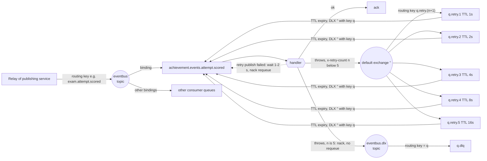

# Messaging (RabbitMQ, outbox, inbox)

How services exchange events: the shared library `@server/messaging` (`libs/messaging/src`), the transactional outbox and its relay, the idempotent inbox, and the RabbitMQ topology with per-consumer retry and dead-letter queues. Operational runbooks (DLQ replay, alerts, one-time queue recreation) are in [`docs/operations/observability.md`](../operations/observability.md) and [`docs/operations/upgrade-notes.md`](../operations/upgrade-notes.md).

## 1. The pieces

| Piece                                | File                                                              | Role                                                                                                    |
| ------------------------------------ | ----------------------------------------------------------------- | ------------------------------------------------------------------------------------------------------- |
| `EventEnvelope`, `createEnvelope`    | `libs/messaging/src/lib/envelope.ts`                              | Wire format `{ id, type, occurredAt, payload }`                                                         |
| `unwrapEvent`                        | same                                                              | Consumer side: returns `{ id, type, payload }` for an envelope, `{ payload }` for a legacy bare message |
| `OutboxPublisher.add`                | `libs/messaging/src/lib/outbox.publisher.ts`                      | Inserts an `outbox_events` row in the **current** transaction                                           |
| `OutboxRelay`                        | `libs/messaging/src/lib/outbox.relay.ts`                          | Polls `outbox_events`, publishes to `eventbus`, marks rows published, cleans up                         |
| `InboxService.claim`                 | `libs/messaging/src/lib/inbox.service.ts`                         | Records `(eventId, consumer)` in `inbox_events`; returns `false` for a duplicate                        |
| `defineConsumerQueue`                | `libs/messaging/src/lib/dead-letter.ts`                           | One definition per consumer queue: subscribe options + retry/DLQ queue declarations                     |
| `retryOnConflict`, `jitter`          | `libs/messaging/src/lib/retry-on-conflict.ts`                     | In-process retry of a fresh transaction on optimistic-lock conflicts                                    |
| `MessagingModule.forRoot`            | `libs/messaging/src/lib/messaging.module.ts`                      | Wires the above; `relay` option (default `true`) decides whether this process runs `OutboxRelay`        |
| Prisma models                        | `libs/messaging/prisma/messaging.prisma`, copied to every service | `outbox_events`, `inbox_events` (the copies in `apps/*/prisma/schema/messaging.prisma` are identical)   |
| Exchanges `eventbus`, `eventbus.dlx` | `libs/utils/src/configs/rmq.config.ts` (`defaultRmqExchanges`)    | Both `topic`, durable; declared by every service's `sub` connection config                              |

### Tables

| Table (`@@map`) | Columns                                                                                                                                                   | Keys / indexes                                               |
| --------------- | --------------------------------------------------------------------------------------------------------------------------------------------------------- | ------------------------------------------------------------ |
| `outbox_events` | `id uuid` (= envelope id = AMQP `messageId`), `routing_key`, `payload jsonb`, `created_at`, `published_at?`, `attempts`, `next_attempt_at`, `last_error?` | PK `id`; index `(published_at, next_attempt_at, created_at)` |
| `inbox_events`  | `id uuid` (event id), `consumer` (queue name), `processed_at`                                                                                             | PK `(id, consumer)`; index `processed_at`                    |

## 2. Envelope

```json
{
	"id": "6f1c…-uuid",
	"type": "exam.attempt.scored",
	"occurredAt": "2026-11-13T10:00:00.000Z",
	"payload": { "attemptId": "…", "attemptedBy": "…", "score": 7, "totalPoints": 10 }
}
```

- `type` is the routing key (`createEnvelope(routingKey, payload)` in `OutboxPublisher.add`).
- The relay publishes with `persistent: true` and `messageId: <outbox row id>`.
- `unwrapEvent` accepts a bare payload too (no `id`), and `InboxService.claim(undefined, …)` then always returns `true`, so legacy messages are processed but **not deduplicated**. Removing that legacy path is on the backlog (`docs/backlog.md`, Conventions).

**Bare-payload exception.** `exam.writing.submitted` is written with `outbox.add(key, message, { bare: true })` (`apps/exam/src/app/events/publishers/writing-submitted.ts`): the external AI scorer expects the legacy snake_case shape, not the envelope. The AMQP `messageId` is still the outbox row id. Its answer, `exam.writing.scored`, is also bare and is **not** published through an outbox (the AI scorer is an external Python worker, run here by `docker/ai-scorer` in Docker profile `ai` and publishing straight to the broker; the mock has no database and does the same, `apps/mock-ai-scorer/src/app/writing-submitted.handler.ts`). Neither consumer of these two keys uses the inbox; both rely on being safe to re-run (see §7).

## 3. Producer side: `OutboxPublisher.add` inside `@Transactional()`

```ts
@Transactional()
public async execute(command: DeleteExamCommand): Promise<void> {
  const exam = await this.examRepository.findOne(payload.id);
  if (!exam) throw new NotFoundException('Exam not found');
  await this.examRepository.delete(exam);
  await this.outbox.add('exam.exam.deleted', { resourceId: payload.id }); // same transaction
}
```

(`apps/exam/src/app/commands/handlers/management/delete-exam.handler.ts`)

- `add` throws `OutboxPublisher.add must run inside a transaction` when no `@nestjs-cls/transactional` transaction is active, so a forgotten `@Transactional()` fails loudly instead of silently publishing.
- **Why**: the event row commits or rolls back with the business write. There is no window where the data changed but the event is lost (broker down, process crash between commit and publish), and no event for a write that was rolled back. This is the main fix over the previous direct-publish setup (§10).
- Delivery is **at-least-once**: the relay can publish a row and crash before marking it, so consumers deduplicate with the inbox.

## 4. The relay (`OutboxRelay`)

Source: `libs/messaging/src/lib/outbox.relay.ts`.

| Aspect           | Behaviour                                                                                                                                                                                                                               |
| ---------------- | --------------------------------------------------------------------------------------------------------------------------------------------------------------------------------------------------------------------------------------- |
| Start            | `onApplicationBootstrap` starts a `setInterval` every **1000 ms** (`POLL_INTERVAL_MS`); timers are `unref()`'d; cleared in `onModuleDestroy`                                                                                            |
| Overlap          | A `running` flag makes `relayOnce()` return 0 while a batch is in flight, so ticks never overlap inside one process                                                                                                                     |
| Selection        | One interactive transaction (timeout **60 s**): `SELECT id, routing_key, payload, attempts FROM outbox_events WHERE published_at IS NULL AND next_attempt_at <= now() ORDER BY created_at LIMIT 100 FOR UPDATE SKIP LOCKED`             |
| Concurrency      | `FOR UPDATE SKIP LOCKED` lets several replicas of one service relay in parallel: each locks a disjoint set of rows                                                                                                                      |
| Publish          | Rows are published one by one to exchange `eventbus` with the row's routing key, `persistent: true`, `messageId: row.id`, `timeout: 5000 ms` (`PUBLISH_TIMEOUT_MS`)                                                                     |
| Confirm          | `AmqpConnection.publish` goes through an amqp-connection-manager channel wrapper, which is a confirm channel by default (`ChannelWrapper._confirm = true` in `amqp-connection-manager@5.0.0`); the publish resolves on the broker's ack |
| Why the timeout  | amqp-connection-manager queues publishes while disconnected and only rejects on the timeout; without it a broker outage would hang the batch instead of triggering back-off (comment in the source)                                     |
| Success          | `UPDATE outbox_events SET published_at = now()` for that row                                                                                                                                                                            |
| Failure          | `attempts + 1`, `next_attempt_at = now() + min(2^attempts, 300) s`, `last_error = message`, counter `outbox_publish_errors_total{service}` +1, then **`break`**: the rest of the batch waits for the next tick                          |
| Retry limit      | None. A row is retried forever with back-off capped at 300 s (2, 4, 8, … 300 s)                                                                                                                                                         |
| Ordering         | FIFO by `created_at` within one relay tick. Not strict overall: a failed row is pushed back by its back-off while later rows are published on the next tick; with several replicas there is no global order                             |
| Cleanup          | First run 60 s after bootstrap, then every 24 h: `DELETE FROM outbox_events WHERE published_at < now() - 7 days` and `DELETE FROM inbox_events WHERE processed_at < now() - 7 days`                                                     |
| Metrics          | Observable gauges `outbox_pending_events{service}` and `outbox_oldest_pending_age_seconds{service}` (one `count(*)`/`min(created_at)` query per metric export), counter `outbox_publish_errors_total{service}`                          |
| `mandatory` flag | Not set. An event published to `eventbus` with no bound queue is confirmed and dropped (hence "start consumers before publishers", and a backlog item)                                                                                  |

Note the cleanup runs on the relay only, so the inbox of a `relay: false` service is never pruned by this code (not verified at runtime; follows from `MessagingModule.forRoot` only registering `OutboxRelay` when `relay` is true).

### Which processes run the relay

| Service        | `MessagingModule.forRoot` (file)                 | `relay` | AMQP connection | Writes to the outbox?                         |
| -------------- | ------------------------------------------------ | ------- | --------------- | --------------------------------------------- |
| auth           | `apps/auth/src/auth.module.ts`                   | `true`  | `pub` (default) | yes                                           |
| exam           | `apps/exam/src/exam.module.ts`                   | `true`  | `pub`           | yes                                           |
| live           | `apps/live/src/live.module.ts`                   | `true`  | `pub`           | yes                                           |
| resource       | `apps/resource/src/resource.module.ts`           | `true`  | `pub`           | yes                                           |
| achievement    | `apps/achievement/src/achievement.module.ts`     | `true`  | `pub`           | yes (`achievement.badge.earned`)              |
| authorization  | `apps/authorization/src/authorization.module.ts` | `true`  | `sub`           | no `outbox.add` call today (it only consumes) |
| file-service   | `apps/file-service/src/file.module.ts`           | `false` | -               | no                                            |
| notification   | `apps/notification/src/notification.module.ts`   | `false` | -               | no                                            |
| mock-ai-scorer | no `MessagingModule` (no database)               | -       | default         | no; publishes `exam.writing.scored` directly  |

`relay: false` services have no outbox metrics or alerts (backlog, Conventions).

## 5. Consumer side: `InboxService.claim`

```ts
const { count } = await this.txHost.tx.inboxEvent.createMany({
  data: [{ id: eventId, consumer: consumer }],
  skipDuplicates: true, // INSERT … ON CONFLICT DO NOTHING
});
return count === 1; // 0 => duplicate, counted in inbox_duplicates_total{service,consumer}
```

- Must run inside the handler's transaction (throws otherwise), so the claim commits **together with** the handler's writes. If the handler fails, the claim rolls back and the redelivery is processed again; if it committed, the redelivery is skipped.
- **Why not `create` + catch P2002**: a unique violation inside a PostgreSQL transaction aborts the transaction (SQLSTATE 25P02, "current transaction is aborted"), so every later statement of the same handler would fail. `ON CONFLICT DO NOTHING` never raises (comment in `inbox.service.ts`).
- `consumer` is the queue name (`q.name` from `defineConsumerQueue`), so two queues bound to the same key dedupe independently.
- Inbox rows are deleted after 7 days by the relay cleanup; a redelivery older than that would be processed again.

Handler shapes found in the code:

| Pattern                                                                                                                                                                                                             | Used by                                                                                                                  |
| ------------------------------------------------------------------------------------------------------------------------------------------------------------------------------------------------------------------- | ------------------------------------------------------------------------------------------------------------------------ |
| `@UseCls()` + `@RabbitSubscribe(...)` + `@Transactional()` on the method; `claim` first, then `validatePayload`, then work                                                                                          | authorization (`apps/authorization/src/app/events/handlers/*-ownership.handler.ts`), file-service, notification          |
| `inTransactionRetryingConflicts(txHost, work)`: `retryOnConflict(() => txHost.withTransaction(work), { attempts: 3, isConflict: P2025 })`; the claim is inside `work`, so each try re-claims in a fresh transaction | achievement (`apps/achievement/src/app/events/handlers/version-conflict.ts`, `login.handler.ts`, `attempt-*.handler.ts`) |
| No inbox (bare input); `retryAttemptConflicts` = `retryOnConflict(work, { attempts: 6, delayMs: jitter(10, 60) })` around a `@Transactional()` method (`apps/exam/src/app/services/attempt-conflict-retry.ts`)      | exam `WritingScoredHandler` (`apps/exam/src/app/events/handlers/writing-scored.handler.ts`)                              |
| No inbox, no transaction                                                                                                                                                                                            | mock-ai-scorer `WritingSubmittedHandler`                                                                                 |

`retryOnConflict` (`retry-on-conflict.ts`) re-runs `fn` up to `attempts` times when `isConflict(error)` and rethrows anything else (and the last conflict); `fn` must open a fresh transaction per call. A rethrown error then goes to the broker-level retry below.

## 6. RabbitMQ topology

### `defineConsumerQueue(name, opts?)`

`libs/messaging/src/lib/dead-letter.ts`. Defaults: `maxAttempts 5`, `baseDelayMs 1000`, `maxDelayMs 60000`. Returns:

- `name`: the queue name, also the inbox consumer name;
- `subscribe`: spread into `@RabbitSubscribe`: `queue: name`, `queueOptions: { durable, deadLetterExchange: 'eventbus.dlx', deadLetterRoutingKey: name }`, and `errorHandler: consumerFailureHandler(name, policy)` (overrides `errorBehavior`);
- `queues`: spread into the app's `sub` RabbitMQ config: `<name>.dlq` bound to `eventbus.dlx` with routing key `<name>`, plus `<name>.retry.1 … .5`, each `durable`, `messageTtl = min(1000 · 2^(n-1), 60000)` (1, 2, 4, 8, 16 s), `deadLetterExchange: ''` (default exchange), `deadLetterRoutingKey: <name>`, no consumer.

Because both halves come from one policy object, a handler can't retry into a `<q>.retry.N` that was never declared (which would be confirmed by the default exchange and lost).

### What happens when a handler throws

`GlobalRmqExceptionFilter` (`libs/utils/src/filters/global.rmq.filter.ts`) logs and rethrows; golevelup then calls `consumerFailureHandler`:

1. `consumer_failures_total{consumer=<q>}` +1 (every failed delivery, so a message that never succeeds counts 6 times).
2. Read `x-retry-count` (0 if absent). If `>= 5`: `nack(requeue=false)` → the queue's DLX `eventbus.dlx` with routing key `<q>` → `<q>.dlq`.
3. Otherwise publish the **same content** to the default exchange `''` with routing key `<q>.retry.<n+1>`: `persistent`, original properties (`messageId`, `correlationId`, `contentType`, `timestamp`, …; not `expiration`/`userId`), original headers minus `x-death`/`x-first-death-*`/`x-last-death-*`, plus `x-retry-count = n+1`. On a confirm channel it waits for the broker's confirm.
4. Confirmed → `ack` the original. The copy waits in `<q>.retry.N` for its TTL, then dead-letters through `''` back to `<q>` **only**. Other queues bound to the same routing key never see the retry.
5. Retry publish failed → sleep `1000 + random(0..999)` ms (`RETRY_PUBLISH_FAILURE_DELAY_MS`), then `nack(requeue=true)` so the original isn't lost and doesn't hot-loop.



### Prefetch

`apps/achievement/src/configs/rmq.sub.config.ts` sets `prefetchCount: 1` (one unacked message per consumer, so one instance works through each queue serially; the comment explains the remaining races are absorbed by `retryOnConflict` plus broker retries). `apps/mock-ai-scorer/src/configs/rmq.config.ts` sets `200` (each message sleeps for the mock delay while unacked). Other services use the library default.

## 7. Complete event table

All events go through exchange `eventbus` (topic). Every consumer queue below is created with `defineConsumerQueue`, so each also has `<q>.retry.1..5` and `<q>.dlq`.

| Routing key                           | Published by (file)                                                                                                                             | Shape    | Payload                                                                                           | Consumer queue (binding)                                                                                                                                                                                 | Consumer (handler) and effect                                                                                                                                                                                   |
| ------------------------------------- | ----------------------------------------------------------------------------------------------------------------------------------------------- | -------- | ------------------------------------------------------------------------------------------------- | -------------------------------------------------------------------------------------------------------------------------------------------------------------------------------------------------------- | --------------------------------------------------------------------------------------------------------------------------------------------------------------------------------------------------------------- |
| `auth.user.login`                     | auth `app/events/publisher/logged-in.publisher.ts` (mail login and Google login to an existing account; not on mail register or Google sign-up) | envelope | `{ uid, date }`                                                                                   | `achievement.events.user.login`                                                                                                                                                                          | achievement `LoginHandler`: login streak/total, may award badges                                                                                                                                                |
| `auth.user.locked`                    | auth `identity-locked.publisher.ts` (lock identity)                                                                                             | envelope | `{ identityId, lockedBy }`                                                                        | **none in this repo**                                                                                                                                                                                    | -                                                                                                                                                                                                               |
| `auth.file.added`                     | auth `file-added.publisher.ts` (avatar change)                                                                                                  | envelope | `{ fileId }`                                                                                      | `file.events.file.added` (`*.file.added`)                                                                                                                                                                | file-service `FileAddedHandler`: `refCount + 1`                                                                                                                                                                 |
| `auth.files.removed`                  | auth `files-removed.publisher.ts`, BullMQ job every 60 s draining `deleted_files`                                                               | envelope | `{ files: [{ id, count }] }`                                                                      | `file.events.files.removed` (`*.file.removed`, `*.files.removed`)                                                                                                                                        | file-service `FileRemovedHandler`: `decrementRef`                                                                                                                                                               |
| `exam.file.added`                     | exam `app/events/publishers/file-added.publisher.ts` (update section/question)                                                                  | envelope | `{ fileId }`                                                                                      | `file.events.file.added`                                                                                                                                                                                 | as above                                                                                                                                                                                                        |
| `exam.files.removed`                  | exam `files-removed.publisher.ts`, BullMQ job every 60 s                                                                                        | envelope | `{ files: [...] }`                                                                                | `file.events.files.removed`                                                                                                                                                                              | as above                                                                                                                                                                                                        |
| `exam.exam.created`                   | exam `create-exam.handler.ts`                                                                                                                   | envelope | `{ resourceType: 'exam', resourceId, ownerId }`                                                   | `authorization.events.exam.created`                                                                                                                                                                      | authorization: register ownership (first owner wins)                                                                                                                                                            |
| `exam.exam.deleted`                   | exam `delete-exam.handler.ts`                                                                                                                   | envelope | `{ resourceId }`                                                                                  | `authorization.events.exam.deleted`                                                                                                                                                                      | authorization: remove ownership                                                                                                                                                                                 |
| `exam.attempt.submitted`              | exam `attempt-submitted.publisher.ts`, called in `EndAttemptHandler` (tx)                                                                       | envelope | `{ attemptId, attemptedBy }`                                                                      | `achievement.events.attempt.submitted`                                                                                                                                                                   | achievement: attempt counter badges                                                                                                                                                                             |
| `exam.attempt.scored`                 | exam `attempt-scored.publisher.ts`, called in the in-process `AttemptSubmittedHandler` (new tx, after the submit commit)                        | envelope | `{ attemptId, attemptedBy, score, totalPoints }`                                                  | `achievement.events.attempt.scored`                                                                                                                                                                      | achievement: score badges                                                                                                                                                                                       |
| `exam.writing.submitted`              | exam `writing-submitted.ts`, same transaction as `exam.attempt.scored`                                                                          | **bare** | `{ attempt_id, response_id, question, content, exam_type, task_type, target_score }`              | `writing.evaluate` (AI scorer, Docker profile `ai`; declared by the worker, not by `defineConsumerQueue`: DLQ `writing.evaluate.dlq`, TTL 1 h) or `mock-ai-scorer.writing.submitted` (profile `mock-ai`) | AI scorer: grade with the LLM ([flows/exam.md](flows/exam.md)); mock: random bands. Either publishes `exam.writing.scored`                                                                                      |
| `exam.writing.scored`                 | AI scorer worker (`docker/ai-scorer`, direct publish) or mock-ai-scorer (`amqpConnection.publish`, no outbox)                                   | **bare** | `{ status, attempt_id, response_id, data?, error_code?, error_message? }`                         | `exam.events.writing.scored`                                                                                                                                                                             | exam `WritingScoredHandler`: save feedback (`scorer_data`), recompute attempt score; `status: 'error'` throws → retry/DLQ                                                                                       |
| `live.room.created`                   | live `app/services/chat.service.ts` `createRoom`                                                                                                | envelope | `{ resourceType: 'room', resourceId, ownerId }`                                                   | `authorization.events.room.created`                                                                                                                                                                      | authorization: register ownership                                                                                                                                                                               |
| `live.room.deleted`                   | live `chat.service.ts` `removeRoom`                                                                                                             | envelope | `{ resourceId }`                                                                                  | `authorization.events.room.deleted`                                                                                                                                                                      | authorization: remove ownership                                                                                                                                                                                 |
| `resource.resource.created`           | resource `app/events/resource-events.publisher.ts` (blog, flash card create)                                                                    | envelope | `{ resourceType: 'blog' \| 'flashcard', resourceId, ownerId }`                                    | `authorization.events.resource.created`                                                                                                                                                                  | authorization: register ownership                                                                                                                                                                               |
| `resource.resource.deleted`           | same (blog delete, card delete, one per card on list delete)                                                                                    | envelope | `{ resourceType, resourceId }`                                                                    | `authorization.events.resource.deleted`                                                                                                                                                                  | authorization: remove ownership                                                                                                                                                                                 |
| `resource.report.created`             | resource `report.service.ts` `createReport`                                                                                                     | envelope | `{ reportId, reportedBy, type, title, targetType, targetId }`                                     | `notification.events.report.created`                                                                                                                                                                     | notification `ReportCreatedHandler`: asks auth for the admins (`FindIdentityIdsByRole`), notifies each with `reportEnabled` on                                                                                  |
| `resource.blog-comment.created`       | resource `blog-comment.service.ts` `createComment` (same tx)                                                                                    | envelope | `{ commentId, blogId, blogTitle, blogAuthorId, authorId, parentAuthorId, excerpt }`               | `notification.events.blog-comment.created`                                                                                                                                                               | notification `BlogCommentCreatedHandler`: replied-to author (`comment_reply`, pref `commentReplyEnabled`) and post author (`blog_comment`, `blogCommentEnabled`); never the writer, one notification per person |
| `resource.forum-reply.created`        | resource `forum.service.ts` `createReply` (same tx)                                                                                             | envelope | `{ replyId, threadId, threadTitle, threadAuthorId, authorId, quotedAuthorId, excerpt, position }` | `notification.events.forum-reply.created`                                                                                                                                                                | notification `ForumReplyCreatedHandler`: quoted author (`comment_reply`) and thread author (`forum_reply`, `forumReplyEnabled`); link to the reply's page                                                       |
| `resource.report.status-changed`      | resource `report.service.ts` `updateReport` (only when status changes)                                                                          | envelope | `{ reportId, reportedBy, status, title }`                                                         | `notification.events.report.status-changed`                                                                                                                                                              | notification: create a notification if the user's `reportEnabled` preference is on                                                                                                                              |
| `resource.flashcard-proposal.created` | resource `flashcard-proposal.service.ts` `createFlashCardProposal`                                                                              | envelope | `{ proposalId, targetListId, targetListName, targetOwnerId, authorId, title }`                    | `notification.events.flashcard-proposal.created`                                                                                                                                                         | notification: tell the list owner (type `flashcard`, `action` = the proposal page)                                                                                                                              |
| `resource.flashcard-proposal.decided` | resource `flashcard-proposal.service.ts` accept/reject                                                                                          | envelope | `{ proposalId, targetListId, targetListName, authorId, title, status, decidedBy, decisionNote }`  | `notification.events.flashcard-proposal.decided`                                                                                                                                                         | notification: tell the proposer (`ACCEPTED`/`REJECTED`; not when they decided it themselves)                                                                                                                    |
| `achievement.badge.earned`            | achievement `infra/repositories/badge-manager.prisma.repository.impl.ts` `onBadgeAdded`                                                         | envelope | `{ uid, badgeName }` (display name)                                                               | `notification.events.badge.earned`                                                                                                                                                                       | notification: create "Achievement Unlocked!" notification if `achievementEnabled`                                                                                                                               |

Notes:

- `file.events.files.removed` also binds `*.file.removed` (singular); no publisher of a `*.file.removed` key exists in the repo.
- Exchanges: `eventbus` (topic, business events), `eventbus.dlx` (topic, dead letters, routing key = source queue name), and the default exchange `''` (retry hops only).
- Queues per consumer: `<q>`, `<q>.retry.1..5`, `<q>.dlq`. Consumer queues: `achievement.events.user.login`, `achievement.events.attempt.submitted`, `achievement.events.attempt.scored`, `authorization.events.{exam,room,resource}.{created,deleted}`, `file.events.file.added`, `file.events.files.removed`, `notification.events.badge.earned`, `notification.events.report.{created,status-changed}`, `notification.events.flashcard-proposal.{created,decided}`, `notification.events.blog-comment.created`, `notification.events.forum-reply.created`, `exam.events.writing.scored`, `mock-ai-scorer.writing.submitted` (mock only). The AI scorer's `writing.evaluate` / `writing.evaluate.dlq` are declared by the external worker with its own retry scheme (header `x-retry-count`, re-published to its own queue).

## 8. One event end to end: writing submission → scorer → exam

```mermaid
sequenceDiagram
  autonumber
  participant B as Browser (via FE proxy)
  participant G as Gateway
  participant E as exam
  participant EDB as exam_db
  participant R as exam OutboxRelay
  participant MQ as RabbitMQ eventbus
  participant S as AI scorer / mock-ai-scorer
  participant A as achievement

  B->>G: POST end attempt
  G->>E: gRPC ExamPracticeService.EndAttempt
  E->>EDB: tx: save attempt (versioned) + outbox exam.attempt.submitted
  E-->>G: ok
  Note over E: after commit: eventBus.publishAll(...) in process
  E->>EDB: tx (AttemptSubmittedHandler.score): evaluate score, save,<br/>outbox exam.attempt.scored (envelope) + exam.writing.submitted (bare)
  loop every 1 s
    R->>EDB: SELECT ... FOR UPDATE SKIP LOCKED LIMIT 100
    R->>MQ: publish (persistent, messageId = row id, confirm, 5 s timeout)
    R->>EDB: UPDATE published_at = now()
  end
  MQ->>A: achievement.events.attempt.scored
  A->>A: tx: inbox.claim, update score badges (retry on version conflict)
  MQ->>S: exam.writing.submitted (bare)
  S->>S: score (AI: LLM, ~1 min per essay, one at a time; mock: random 4.0-8.5 after 1-3 min, unacked)
  S->>MQ: publish exam.writing.scored (bare, direct)
  MQ->>E: exam.events.writing.scored
  E->>EDB: tx: save scorer_data, recompute attempt score (retry on version conflict)
  alt handler throws
    E-->>MQ: copy to exam.events.writing.scored.retry.N, ack original
    MQ-->>E: redelivered after 1/2/4/8/16 s, then exam.events.writing.scored.dlq
  end
```

Caveats documented in `docs/backlog.md`: scoring runs in process after the `endAttempt` commit, so a crash or a `score()` failure between the two transactions loses `exam.attempt.scored` and `exam.writing.submitted` (the error is only logged in `AttemptSubmittedHandler.handle`); and `exam.attempt.scored` is sent once, before writing feedback arrives, so achievement score badges ignore writing points.

## 9. Delivery guarantees summary

| Stage                       | Guarantee                                                                                                                          |
| --------------------------- | ---------------------------------------------------------------------------------------------------------------------------------- |
| Business write → outbox row | Atomic (same Postgres transaction)                                                                                                 |
| Outbox → broker             | At-least-once, retried forever with back-off; dropped if no queue is bound (no `mandatory`)                                        |
| Broker → handler            | At-least-once; 5 retries with back-off, then DLQ                                                                                   |
| Handler side effects        | Exactly-once per `(eventId, queue)` for enveloped events within the 7-day inbox retention; bare events rely on idempotent handlers |

## 10. Before vs after this branch

From `git log main..HEAD` (commits `e14f4c1` relay, `4faaf16`/`dca6965` inbox, `7b50283` dead-letter helpers, `cac394c` tables, `8cbe1f4` route everything through the outbox, `368ab59` exponential back-off, `7dc0659` `defineConsumerQueue` and retry-publish back-off, `784c076` badge.earned) and `git diff main...HEAD -- libs apps/*/src/configs`:

| Concern                     | `main`                                                                                                                                                                                                                                                                                                                                                        | This branch                                                                                                 |
| --------------------------- | ------------------------------------------------------------------------------------------------------------------------------------------------------------------------------------------------------------------------------------------------------------------------------------------------------------------------------------------------------------- | ----------------------------------------------------------------------------------------------------------- |
| Publishing                  | `amqpConnection.publish('eventbus', key, payload, { persistent: true })` right after the DB write, often in `try { … } catch { logger.error }` (e.g. `apps/resource/src/app/services/blog.service.ts`, `apps/live/src/app/services/chat.service.ts` on `main`). An outage or crash lost the event; a publish before commit could announce a rolled-back write | `OutboxPublisher.add` in the same transaction, relay with back-off                                          |
| Message format              | Bare payloads, no event id                                                                                                                                                                                                                                                                                                                                    | Envelope with `id` (except the two writing keys)                                                            |
| Idempotency                 | None                                                                                                                                                                                                                                                                                                                                                          | Inbox per `(eventId, queue)`                                                                                |
| Error handling in consumers | Several handlers swallowed errors (`try { … } catch (e) { this.logger.error(e) }` in achievement `login.handler.ts`, `attempt-scored.handler.ts`, notification `achievement-earned.handler.ts`, file-service `file-added.handler.ts` on `main`), so failures were acked and lost                                                                              | Handlers must throw; broker-level retries then DLQ                                                          |
| Exchanges                   | `eventbus` only in `defaultRmqExchanges`; per-service DLX exchanges `achievement.dlx`, `notification.dlx`, `exam.dlx`, plus `exam.retry` (direct)                                                                                                                                                                                                             | `eventbus` + one shared `eventbus.dlx`; retries via the default exchange                                    |
| Dead letters                | achievement: `achievement.events.*.dlq` via `achievement.dlx`; notification via `notification.dlx`; exam: `exam.writing.result.dlq`; authorization queues had `queueOptions: { durable: true }` and **no DLX**, so a NACKed message was discarded                                                                                                             | Every consumer queue: `<q>.dlq` via `eventbus.dlx`, routing key `<q>`                                       |
| Retries                     | Only exam `writing.scored`: `libs/utils/src/configs/rmq-retry.config.ts` (deleted on this branch) built `exam.retry.writing-scored.1..3` (5 s, 30 s, 120 s) that dead-lettered back to **`eventbus`** with key `exam.writing.scored`, so every subscriber of that key received each retry                                                                     | Every consumer: 5 retries 1-16 s through `<q>.retry.N`, back to `<q>` only                                  |
| Retry publish failure       | n/a                                                                                                                                                                                                                                                                                                                                                           | Wait 1-2 s, nack with requeue                                                                               |
| Observability               | None for messaging                                                                                                                                                                                                                                                                                                                                            | Outbox/inbox/consumer metrics, Messaging dashboard, `OutboxStuck` and `DeadLetters` alerts, RabbitMQ scrape |
| Missing publishers          | `notification` consumed `achievement.badge.earned` and `resource.report.status-changed`, but nothing on `main` published either (`git grep` on `main`)                                                                                                                                                                                                        | Both published through the outbox                                                                           |

Upgrading a broker from `main` requires deleting the old consumer queues once (their arguments changed, so redeclaring fails with `PRECONDITION_FAILED`) and starting consumers before publishers: see [observability.md "One-time upgrade"](../operations/observability.md#one-time-upgrade-recreate-consumer-queues) and [upgrade-notes.md](../operations/upgrade-notes.md).

## 11. Observations (from reading the code, not verified at runtime)

- Fixed on this branch: achievement's `onBadgeAdded` and authorization's `registerOwnership` used to catch P2002 inside the handler transaction (which leaves PostgreSQL rejecting every later statement, 25P02). Both now use `createMany({ skipDuplicates: true })` (`ON CONFLICT DO NOTHING`), like `InboxService`.
- The relay holds the selected rows' locks for the whole batch; the transaction timeout is 60 s and each publish can take up to 5 s, but the first failure ends the batch.
